# SheetCam / "AI Camera – Music Reader" — user-flow audit

- Repo: `yishengjiang99/omr-sheet-cam` @ `736d0f6` (main, 2026-10-13). iOS/iPadOS 17+, bundle `com.ragnus.vp`, home-screen name **SheetCam**.
- Audit date: 2026-10-17 (America/Los_Angeles). Auditor mode: **static code read only** (read-only on repo).
- **Method / honesty statement.** The box is Linux with no Xcode/simulator, so **the app was never run**. Every flow below is *derived from SwiftUI/AVFoundation/StoreKit code*, `Info.plist` build settings in `project.pbxproj`, tests, docs and CI. Anything not provable from code is tagged **(inferred)** or **[RUNTIME]** (needs a device/simulator to confirm). Line refs are `path:line` at the SHA above; `App/` = `Sources/App/`.
- Not found in the repo (so not audited as flows): onboarding screens, accounts/login, cloud sync, iPad-specific layouts, in-app note editing, PDF/image export, widgets/extensions, push notifications, any server API other than `POST https://photo.grepawk.com/api/telemetry`. No open issues; PRs 1–5 are all merged.
- Evidence read: README, TODO.md, AGENTS.md, docs/{SPEC,TESTING,asc/*,omr-iap-xcode-prompt}, all of `Sources/App/**`, SF2Player interruption code, `OMRSheetCam.storekit`, `OMRSheetCam.xcodeproj` (usage strings, scheme), `Tests/**` file list, `.github/workflows/*`, live privacy page https://grepawk.com/music-reader/privacy.html (dated 2026-10-12).

## How to read this file

- **IDs are stable.** `F<n>` = core app flows, `P<n>` = Pro / in-app-purchase flows. Steps are `F3.4`, `P3.2`. Bug titles should be `[F3.4] summary` (see `bug-template.md`).
- Each step has: **Expected** behavior, **Acceptance** (concrete, testable check), **Risk / evidence** (R = suspected trouble; code ref).
- Risk level in the index: H = a likely user-visible bug or revenue/compliance risk was found in code; M = fragile / unverified; L = low.
- Flow diagrams are Mermaid. The same top-level overview is rendered to `overview.png` (source `overview.mmd`).

## Navigation model (from `App/RootFlowView.swift`)

`NavigationStack` rooted at **Library** (home). Pushed routes: `.camera`, `.result(photo)`, `.player(route)`. Sheets on the root: **Settings** (`showSettings`), **Paywall** (`quota.showPaywall`). Sheet inside Player: **Library** (no camera/photo entry points). One app-wide `PlaybackController.shared` + `StoreKitManager` (root `@StateObject`) injected as environment objects.

## Key persisted state (UserDefaults unless noted)

| Key / store | Meaning | Written at |
|---|---|---|
| `omr.freeScansUsed`, `omr.freeScansDate` | free-tier daily counter, date string `yyyy-MM-dd` (device time zone) | `App/Services/ScanQuota.swift:26-36` |
| `omr.isPro`, `omr.proTransactionId` | locally cached Pro entitlement flag | `App/Services/StoreKitManager.swift:140,143-150` |
| `telemetry.anonId / sessionId / sessionTs` | anonymous id, 30-min session | `App/Services/Analytics.swift` |
| `playback.program`, `playback.tempo` | instrument (default Piano) / tempo (default 1.0×) | `App/Settings/AppSettings.swift:47,54` |
| `developerMode.enabled` | hidden Developer section | `AppSettings.swift:111` |
| `Documents/captures/*.jpg` | every scanned photo (upright JPEG q0.9) | `App/Capture/CaptureStore.swift:38`, `ResultScreen.swift:219` |
| `Application Support/playlist/{index.json,*.mid,*.layout.json}` | Library | `App/Player/PlaylistStore.swift` |
| `Application Support/diagnostics/events.jsonl` | local event log (never uploaded) | `App/Diagnostics/DiagnosticsLog.swift` |

## Permissions (from `project.pbxproj:682-683`, generated Info.plist)

- `NSCameraUsageDescription` = "Take photos of sheet music to read and play them."
- `NSPhotoLibraryUsageDescription` = "AI Camera - Music Reader can open a photo of sheet music from your library…"
- **No** microphone, location, notifications, tracking (ATT) or `UIBackgroundModes` keys. `PrivacyInfo.xcprivacy` declares telemetry + purchase history, `NSPrivacyTracking=false`.
- Photo access is via `PhotosPicker` (out-of-process, no prompt). The code never calls `PHPhotoLibrary.requestAuthorization`, but has a `PHAsset` fallback (`App/Capture/PhotoLibraryImport.swift:44-60`) — see F4.5.
- Orientation: iPhone portrait + landscape L/R, iPad all four (`project.pbxproj:686-687`).

## Index (26 flows)

| Flow ID | Name | Entry point | # steps | Risk |
|---|---|---|---|---|
| F1 | First launch & bootstrap | App icon (cold start) | 8 | M |
| F2 | Library home (browse / search / rename / delete) | Library home (root screen) | 9 | H |
| F3 | Camera capture & camera permission | Library → Camera (CTA/toolbar) | 11 | M |
| F4 | Photos import & "Try sample picture" | Library/Camera → Photos or Try sample | 7 | M |
| F5 | Scan hand-off gate (`handlePhoto`) | `RootFlowView.handlePhoto` (all scan sources) | 6 | H |
| F6 | Recognition: reading screen, progress, warm-up, cancel | Result screen push (Reading view) | 10 | H |
| F7 | Result (success): summary, title, auto-save, Play | Recognition success | 8 | M |
| F8 | Review & correct recognition (what actually exists) | Result → Compare/feedback section | 8 | M |
| F9 | Failure, low-quality and retry | Recognition failure | 10 | M |
| F10 | Player / reader view & playback controls | Result Play / Library row / mini-player | 13 | H |
| F11 | Library playback, mini-player, playlist behavior | Library/Camera mini-player | 4 | M |
| F12 | Save, share & export | Share buttons (Library, Player, Result) | 6 | L |
| F13 | Settings | Gear icon (Library/Camera) | 7 | M |
| F14 | Cross-cutting: errors, offline, interruptions, storage, rotation | System events (offline, memory, rotation, storage) | 7 | M |
| F15 | Developer / diagnostics (hidden) | Settings → Version ×5 taps | 4 | L |
| P1 | Free-tier limits & paywall triggers | Any scan attempt (F5) | 13 | H |
| P2 | Paywall presentation & StoreKit product load | Quota block → paywall sheet | 11 | H |
| P3 | Purchase success | Paywall → Subscribe | 11 | H |
| P4 | Purchase cancel & failure | Paywall → Subscribe (cancel/error) | 7 | M |
| P5 | Pending / Ask to Buy / SCA | Paywall → Subscribe (Ask to Buy/SCA) | 5 | H |
| P6 | Restore purchases | Paywall → Restore purchases | 8 | H |
| P7 | Entitlement checks, renewal, expiry, refund, offline | App launch / Transaction.updates / StoreKit events | 12 | H |
| P8 | Reinstall, new device, backup/restore | Reinstall, new device, backup restore | 7 | H |
| P9 | How paid features unlock and lock | After any entitlement change | 7 | M |
| P10 | Telemetry, privacy & compliance of the purchase funnel | Telemetry & disclosures | 7 | M |
| P11 | App Review & operations reachability | App Review / dev setup / CI | 5 | H |

Total: 26 flows, 211 steps (+ P0 diagram, 24 StoreKit test cases S1–S24 in Part C).

Sections after the flows: **Part C — StoreKit test plan**, **Product gaps and UX observations**, **Riskiest spots**, **What could not be verified**.

## Overview flowchart (also `overview.png`)

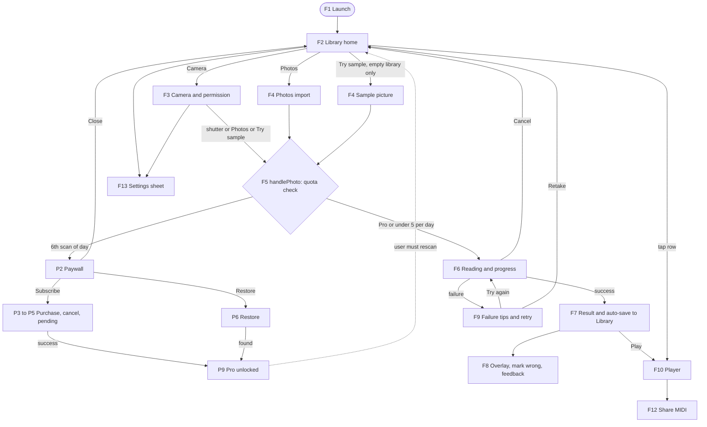
---

# Part A — Core app flows (F)

## F1 — First launch & bootstrap

Entry: tap app icon (cold start). No onboarding/permission prompt at launch: camera permission is deferred until the Camera screen opens (F3).

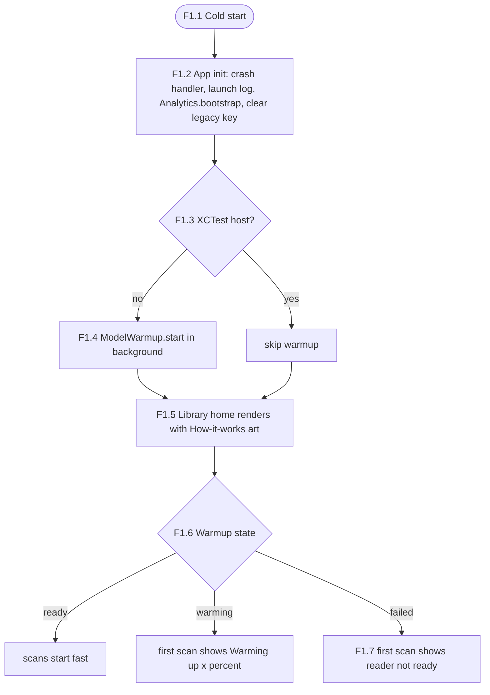

| ID | Step | Expected | Acceptance check | Risk / evidence |
|---|---|---|---|---|
| F1.1 | Launch | Library (title "Library", large) appears; no permission dialog; no blocking spinner | Fresh install, airplane mode ON: app reaches Library in <3 s with no alert; `library.howItWorks` and `library.cameraCTA` exist | R: first-run has **no explanation of free limit (5/day)** until the 6th scan (see P1) |
| F1.2 | `OMRSheetCamApp.init` | Uncaught-exception handler installed, `launch …` logged, `Analytics.bootstrap()` fires `session_start` + `app_open`, legacy `developer.experimentalPageRecognition` key removed | After launch `events.jsonl` has a `launch` line; UserDefaults lacks the legacy key; one `app_open` POST attempted | `App/OMRSheetCamApp.swift:6-16`. R: `app_open` prop `platform` is dropped by the Analytics key filter (`"lat"` matches `"platform"`, `Analytics.swift:53`) — harmless but shows the filter over-matches |
| F1.3 | XCTest guard | Warmup skipped only when `XCTestConfigurationFilePath` set | In a normal launch env var is absent → warmup starts | `OMRSheetCamApp.swift:14` |
| F1.4 | Background warmup | SegNet+encoder (CoreML EP) + decoder (CPU) sessions created off main thread; `ModelWarmup.state` idle→warming→ready | Within ~30 s of launch on device `state == .ready`; main thread never blocked >100 ms (UI scroll stays 60 fps) | `App/Inference/ModelWarmup.swift:106-143`. R: cold CoreML compile can take ~30 s [RUNTIME]; no UI indicator on Library that models are loading |
| F1.5 | Home render | Empty library shows "No scans yet…" + **Try sample picture** + the two sample rows ("Ode to Joy (sample)", "C major scale (sample)") | With no scans: texts and both samples visible; samples have no delete (swipe not offered; menu has no Delete) | `App/Player/LibraryScreen.swift:69-100`; `PlaylistStore.swift:21` |
| F1.6 | Warmup state at first scan | If user scans before ready, Reading screen shows "Warming up… x%" with ETA | Start scan <5 s after launch → title string begins "Warming up…", percent monotonic, then switches to "Reading music…" | `ReadingView.swift:19-35`, `PageRecognitionService.swift:252-262` |
| F1.7 | Warmup failure (models missing/bad) | Scan fails with "The music reader isn't ready" (`readerUnavailable`) and a **Try again** (not Retake) button; warmup retried on next scan | Delete `models/` from a debug bundle → scan → error title matches; restore → Try again succeeds without app restart | `ScanFailure.swift:31-32,67`; `ModelWarmup.swift:92-97,170`. R: **this failed scan already consumed 1 of 5 free scans** (quota is taken before recognition, F5.3) |
| F1.8 | Memory-warning mid-session | Warm sessions released; next scan re-warms with "Reloading the music models" copy | Simulate memory warning, scan → subtitle contains "reloading the music models" | `PageRecognitionService.swift:130-134`; `ModelWarmup.swift:158`. TODO.md lists re-warm (~10 s) as open |

## F2 — Library home (browse / search / rename / delete)

Entry: app home; also reachable from Camera "Library" button (pops camera) and Player toolbar (sheet variant without scan buttons).

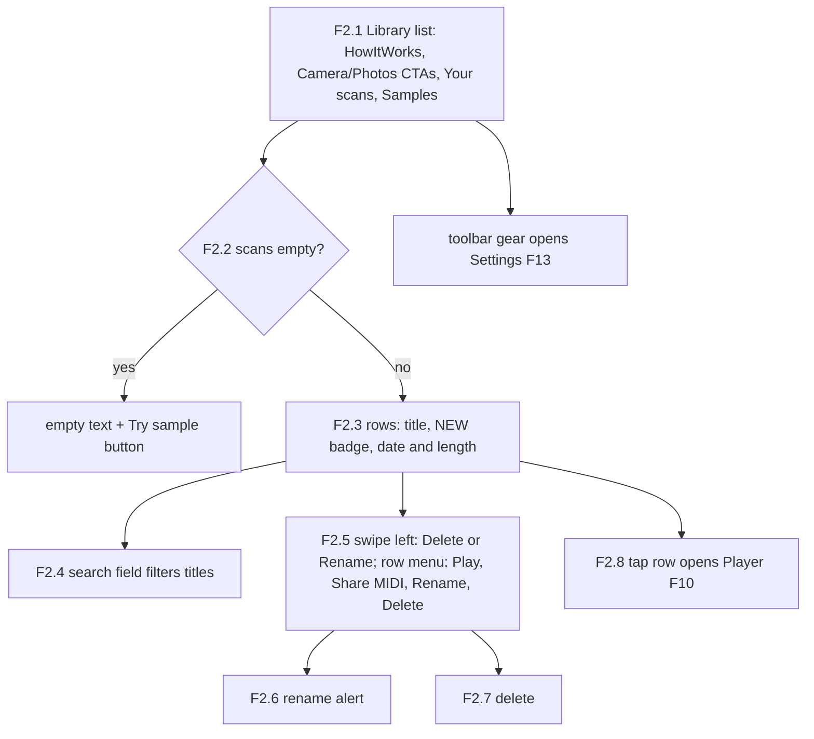

| ID | Step | Expected | Acceptance check | Risk / evidence |
|---|---|---|---|---|
| F2.1 | Home layout | When `query` empty, shows HowItWorksArt + Camera (coral) + Photos (outline) buttons; same two icons in toolbar; gear top-left | All of `library.cameraCTA`, `library.photosCTA`, `library.camera`, `library.photos`, `library.settings` exist and are tappable ≥44 pt | `LibraryScreen.swift:55-67,107-137`. R: duplicate Camera/Photos controls (CTA + toolbar) |
| F2.2 | Empty state | "No scans yet…" + Try sample picture (only when `query` empty and `onTrySample` given) | With 0 scans the button is shown; after the first successful scan it is **gone** (see P11.1) | `LibraryScreen.swift:69-80` |
| F2.3 | Row rendering | Artwork (capture JPEG or glyph), title, "NEW" for scans <24 h, "Today · 0:24"/"Oct 3 · 0:24"; samples show length only; playing row shows waveform and no ⋯ menu | New scan shows NEW; date label uses device calendar; currently playing row has `Now playing` a11y label | `LibraryScreen.swift:57-91,93-102`. R: artwork reads JPEG synchronously from disk per row render (`PlaybackController.artwork`, `:77-80`) → scroll jank with many large scans [RUNTIME] |
| F2.4 | Search | Case-insensitive title contains; hides HowItWorks while typing; "No scans match “q”." when none | Type "ode" → sample row remains; type "zzz" → exact empty copy | `PlaylistStore.swift:185-188`; `LibraryScreen.swift:70` |
| F2.5 | Row actions | Trailing swipe (full-swipe = Delete) and long-press/⋯ menu; samples: Play + Share only | Swipe-delete a scan removes row; sample row has no swipe | `LibraryScreen.swift:83-89`. R: **full-swipe Delete is immediate, no confirm/undo**; also available on the currently-playing row (playback keeps going, then `title` falls back to "Nothing playing"/route title) |
| F2.6 | Rename | Alert with title field → Save updates index.json only; `.mid` file name unchanged; empty/whitespace is ignored | Rename to "  " → title unchanged; rename to "Etude" persists after relaunch | `LibraryScreen.swift:147-152`; `PlaylistStore.swift:174-182` |
| F2.7 | Delete | Removes index entry, `.mid`, `.layout.json`; footer shows "Delete failed: …" on error | After delete, `playlist/` has no files for the entry **and `Documents/captures/<name>.jpg` is removed** | `PlaylistStore.swift:158-168`. **R (confirmed in code): capture JPEG is never deleted** → storage leak and contradicts privacy page ("Deleting a scan … removes them") |
| F2.8 | Open row | Pushes Player with `advanceOnFinish=true` | Tap row → Player opens and autoplays | `RootFlowView.swift:30-33` |
| F2.9 | Index corruption | Unreadable `index.json` → empty list + warn log; entries whose `.mid` is missing are dropped silently | Corrupt index.json by hand → app launches with empty Your scans (no crash) | `PlaylistStore.swift:98-113`. R: **silent data loss** — no user message, and next `saveIndex()` overwrites remaining index; `.mid` orphans stay on disk |

## F3 — Camera capture & camera permission

Entry: Library Camera (CTA or toolbar). Pushes `CameraScreen` (nav bar hidden).

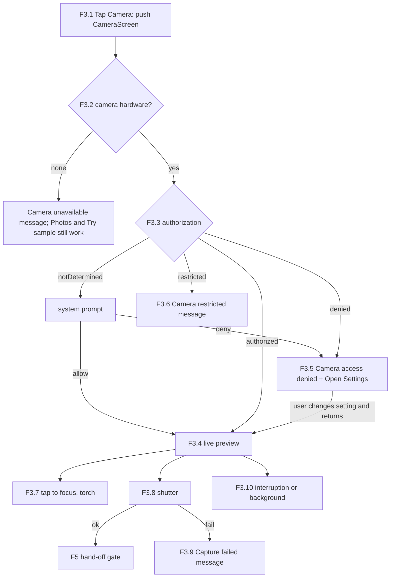

| ID | Step | Expected | Acceptance check | Risk / evidence |
|---|---|---|---|---|
| F3.1 | Open camera | Camera pushed on the stack; nav bar hidden; own gear/Library buttons; mini-player above controls if something is loaded | `scan.settings`, `scan.library`, `scan.photos`, `scan.trySample` exist; opening Camera never triggers a quota check | `RootFlowView.swift:34-40`; `CameraScreen.swift:27-52` |
| F3.2 | No camera (simulator/iPad w/o back wide) | Message "Camera unavailable — Choose a photo…"; shutter disabled/0.35 opacity | On Simulator: message shown, Photos picker still works | `CameraScreen.swift:64-68`; `CameraController.swift:14`. R: iPads/devices whose back camera is not `builtInWideAngleCamera` are treated as "no camera" (inferred) |
| F3.3 | First permission prompt | On `onAppear` → `camera.start()` → `AVCaptureDevice.requestAccess`; while pending UI says "Requesting permission…" | Fresh install → open Camera → iOS dialog with the usage string above; allow → preview starts without leaving screen | `CameraScreen.swift:53,78-79`; `CameraController.swift:90-98`. R: shutter stays disabled until `isRunning`; no timeout if prompt dismissed by system (e.g. incoming call) [RUNTIME] |
| F3.4 | Live preview | Back wide camera, `.photo` preset; "Hold steady over one page" hint; shutter enabled when running | Preview visible ≤1 s; shutter enabled; rotation updates preview via `PreviewRotation` | `CameraController.swift:131-163`. R: rotation/landscape capture angle [RUNTIME] — verify captured JPEG is upright in portrait, landscape-left/right |
| F3.5 | Permission denied | "Camera access denied" + **Open Settings** (opens app settings URL); Photos/Try sample still usable | Deny → text and button shown; tap → iOS Settings; toggle ON, return → preview resumes without relaunch | `CameraScreen.swift:80-90`; scenePhase `.active` calls `start()` at `:55-58`. R: iOS may kill the app when permission toggled [RUNTIME] |
| F3.6 | Restricted (MDM/Screen Time) | "Camera restricted… Choose a photo instead." (no Settings button) | Screen Time camera restriction → copy matches | `CameraScreen.swift:91-95` |
| F3.7 | Focus / torch | Tap preview → autofocus+expose at point with 72 pt yellow box for 1.2 s; torch button only if `hasTorch` | Tap focus box appears and disappears; torch toggles and turns off on `stop()` | `CameraScreen.swift:72-77,100-112,130`; `CameraController.swift:168-204`. R: torch left on when leaving Camera is mitigated (`stop()` sets torchOn=false) but hardware torch off is not explicitly set in `stop()` — verify [RUNTIME] |
| F3.8 | Shutter | Full-res JPEG, quality-prioritized, upright via `normalizedUpright`; button greys while capturing | Tap shutter once → exactly one `onPhoto` call; double-tap during capture ignored (`isCapturing`) | `CameraScreen.swift:174-182,216-226`. R: no shutter haptic/sound cue, no "page framing guide" overlay; capture of very large (48 MP) JPEG + `normalizedUpright` redraw doubles memory [RUNTIME] |
| F3.9 | Capture failure | Footer capsule "Capture failed: …" and log entry | Force `notRunning` (stop session then tap) → message appears; no navigation | `CameraScreen.swift:218-224`; `CameraController.swift:211-214` |
| F3.10 | Interruptions / app background | Session stops in background and restarts on `.active`; interruption reasons mapped to messages ("Camera in use by another app", Split View, too hot) | Background app 10 s → return → preview live; start FaceTime call → message shown, ends → cleared | `CameraScreen.swift:55-58`; `CameraController.swift:36-64,78-85`. R: runtime error other than mediaServicesWereReset leaves "Camera error…" with no retry button |
| F3.11 | Leave camera | `onDisappear` → `stop()`; Library button pops route | Tap Library → back at Library; camera LED off | `RootFlowView.swift:36` |

## F4 — Photos import & "Try sample picture"

Entry: Library Photos CTA / toolbar icon; Camera "Photos"; Library or Camera "Try sample picture".

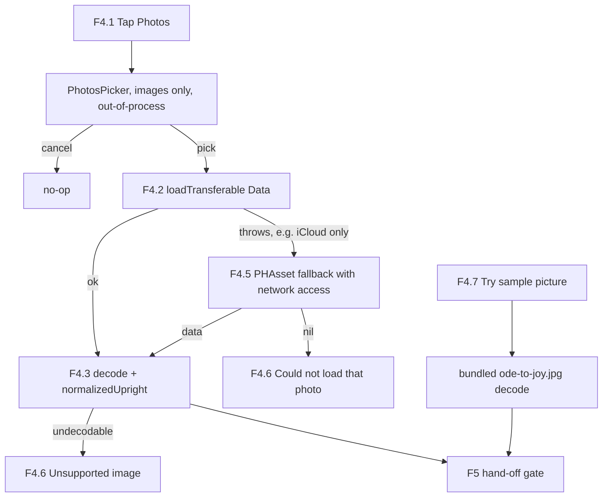

| ID | Step | Expected | Acceptance check | Risk / evidence |
|---|---|---|---|---|
| F4.1 | Open picker | System PhotosPicker (`matching: .images`); no permission prompt | First use on fresh install shows picker with no Photos-permission dialog | `LibraryScreen.swift:171`; `CameraScreen.swift:168`. `NSPhotoLibraryUsageDescription` is set but code never requests authorization |
| F4.2 | Pick | Button shows "Loading…" and disables while loading (Library); `loadingPick` guards double-pick | Pick a 12 MP HEIC → "Loading…" visible, then Reading screen | `LibraryScreen.swift:192-205` |
| F4.3 | Decode | HEIC/JPEG/PNG → upright `UIImage` off main thread | HEIC with EXIF rotation 6 results in upright page on Result | `PhotoLibraryImport.swift:25-32`. R: very large images (e.g. 100 MP panorama, PDF-as-image) → memory spike [RUNTIME]; non-image/Live Photo/video not offered |
| F4.4 | Pick cancelled | No-op | Cancel picker → nothing changes, no error text | picker returns nil |
| F4.5 | iCloud-only photo | `loadTransferable` throws → fallback `PHAsset` fetch with `isNetworkAccessAllowed` | Optimize-storage photo not on device, Wi-Fi on → imports (may take seconds); picker spinner state "Loading…" | `PhotoLibraryImport.swift:36-61`. R: **fallback needs Photos authorization the app never requests**; with limited/no auth `PHAsset.fetchAssets` returns nothing → `noData` ("Could not load that photo") [RUNTIME]. R: offline + iCloud-only → long hang or generic error, no progress/cancel UI |
| F4.6 | Load errors | Library: red text under CTAs (`importError`); Camera: capsule "Could not load that photo: …" | Corrupt file → message shown, stays on screen | `LibraryScreen.swift:63-65`; `CameraScreen.swift:253`. R: `importError` on Library persists until next pick (never auto-cleared) |
| F4.7 | Try sample picture | Bundled Ode-to-Joy JPEG goes through the **same** path incl. quota and Result; Library button only when library has no scans; Camera screen always shows it | Tap → Reading → Result "Found 2 staves…" (value depends on model); counts as a scan | `RootFlowView.swift:66-76`; `CaptureStore.swift:73-101`. R: **consumes 1 of 5 free scans**; sample missing → `Could not load the sample picture` only on Camera, **silent (log only) on Library** (`RootFlowView.swift:68-71`) |

## F5 — Scan hand-off gate (`handlePhoto`)

Single choke point for Camera, Photos, and Sample. This is where free-tier quota is consumed (cross-ref **P1**).

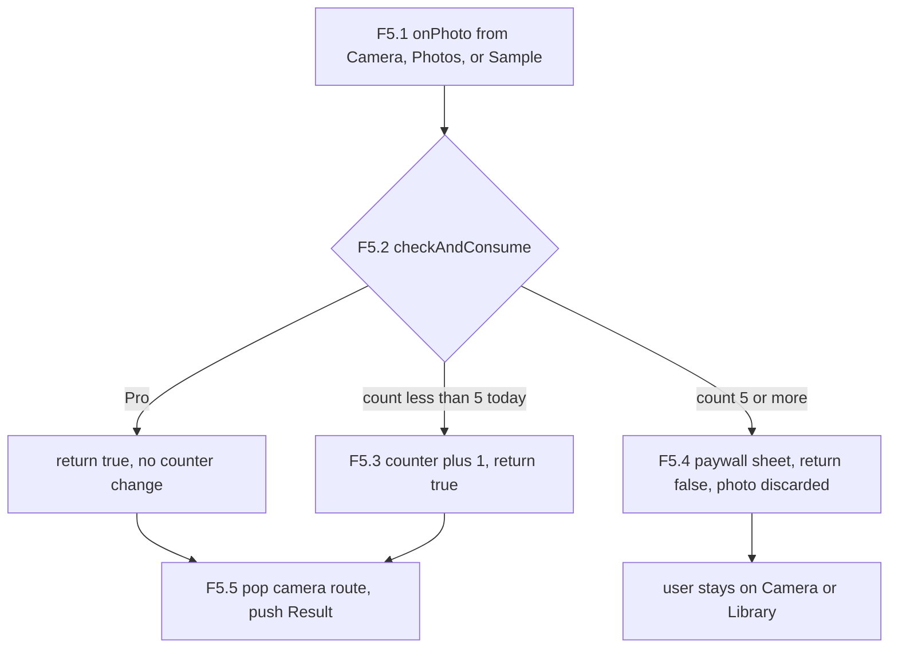

| ID | Step | Expected | Acceptance check | Risk / evidence |
|---|---|---|---|---|
| F5.1 | Receive photo | Any source calls `handlePhoto(CapturedPhoto)` | Instrument: all three sources reach `RootFlowView.handlePhoto` | `RootFlowView.swift:57-62` |
| F5.2 | Pro bypass | `storeKit.isPro` (UserDefaults flag) → true without touching counters | With `omr.isPro=true` 10 scans in a row all proceed; counters unchanged | `ScanQuota.swift:23`. See P9 |
| F5.3 | Consume | If date != today → reset counter to 0 and set date; if `used >= 5` block; else `used+1` **before** any recognition | After 5 successful or failed scans same day, 6th is blocked; counter equals 5 | `ScanQuota.swift:24-37`. R: counted **before** recognition: failures, "Cancel", reader-not-ready and sample scans all burn quota; **"Try again" does not** (retry reuses the same `ResultScreen`) |
| F5.4 | Blocked | `showPaywall=true`, events `free_quota_hit` + `paywall_trigger{reason=quota}`; Camera/Library stays; the photo is dropped | 6th scan → paywall within 300 ms; no Result pushed; no JPEG saved | `ScanQuota.swift:30-34`. R: after a successful purchase the user's pending photo is **lost** and must be retaken/re-picked (P3.7) |
| F5.5 | Navigate to Result | Camera route removed from stack, `.result(photo)` pushed | After scan, Back from Result goes to Library, **not** Camera | `RootFlowView.swift:59-61`. R: Result's button is labeled **"Retake"** but returns to Library (camera was popped) → extra tap; UX mismatch |
| F5.6 | Midnight / time-zone change | New calendar day (device TZ) resets counter | Set device date +1 day → quota resets to 5; set back → date != today → resets again | `ScanQuota.swift:15-19,25-28`. R: trivially bypassable by changing device clock/timezone or reinstalling (no server, no Keychain) — acceptable? product decision; `scansRemaining` computed property is **unused in UI** (no "3 scans left" indicator) |

## F6 — Recognition: reading screen, progress, warm-up, cancel

Entry: `ResultScreen` appears with `outcome == nil` → shows `ReadingView`; `.task(id: attempt)` runs `process()`.

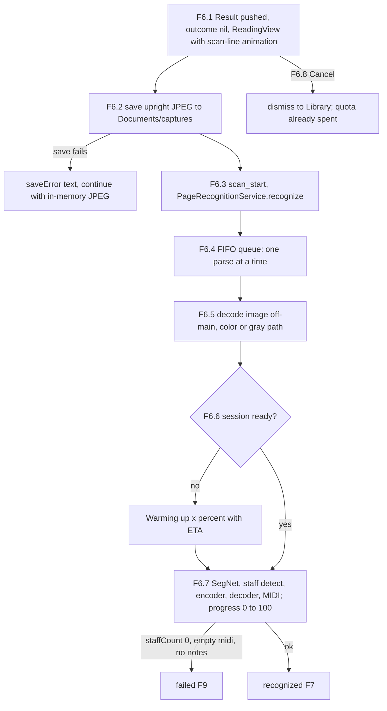

| ID | Step | Expected | Acceptance check | Risk / evidence |
|---|---|---|---|---|
| F6.1 | Reading UI | Dark screen, page thumbnail with sweeping coral line (static if Reduce Motion), card "Reading music… N%", determinate bar, "This usually takes a few seconds", lock line "Read on your iPhone. No internet needed." | Percent only increases within a phase; airplane mode shows identical screen | `ReadingView.swift:41-110`; `RecognitionService.swift:213-219`. R: wording promises "a few seconds" — TODO.md says real-device page parse time is **unmeasured** (open item) |
| F6.2 | Persist capture | JPEG saved before recognition as `captures/yyyyMMdd-HHmmss-SSS.jpg` | After scan start, file exists and is non-empty; on failure to save, "Save failed: …" shown in Result footer and scan continues | `ResultScreen.swift:206-243`. R: disk-full → recognition proceeds but Library entry later has no artwork/sheet mode (inferred) |
| F6.3 | Telemetry | `scan_start`, later `scan_success{notes,ms}` or `scan_fail{ms}` | With network blocked app does not stall (10 s timeout, soft fail) | `ResultScreen.swift:248-256`; `Analytics.swift:201-218` |
| F6.4 | Serialized parse | One page at a time; second request waits for first | Start scan, cancel, immediately start another → second shows progress after first finishes | `PageRecognitionService.swift:201-208`. **R: Cancel does not stop the running parse** (detached tasks ignore cancellation, only checked while queued at `:214`) → next scan waits behind a zombie parse |
| F6.5 | Decode | `RGBXImage.decodePage` honors EXIF, color kept (homr-style); failures → `Gray8Image.DecodeError` text | Unsupported/zero-size image → "This photo couldn't be opened" | `PageRecognitionService.swift:231-243`; `ScanFailure.swift:28` |
| F6.6 | Warm-up wait | If models not warm, progress switches to "Warming up… x%" then resets to 0 for "Reading music…" | First scan after cold start shows both phases; fraction resets at phase change (expected, per `RecognitionProgress.report`) | `RecognitionService.swift:213-219`. R: bar visibly jumps back to 0% at phase change (UX) |
| F6.7 | Parse | Staff detection + decode; peak memory logged; concurrency 2 staffs on iPhone | Full page parse completes; no jetsam; `phys_footprint` peak recorded in log | `PageRecognitionService.swift:275-285`; README "Decoder performance". R: memory on older devices (≤4 GB) with 12–48 MP photos [RUNTIME]; **no parse timeout** — a stuck decode never errors |
| F6.8 | Cancel | Tapping Cancel dismisses to Library (camera already popped) | Tap `reading.cancel` → Library; no Result pushed | `ResultScreen.swift:58` (`dismiss()`); comment at `ReadingView.swift:5` says it "cancels the recognition task" — **it does not cancel the parse (see F6.4)**. R: cancelled scan **keeps its consumed quota**, leaves an **orphan JPEG**, and (inferred) the still-running `process()` may finish and call `saveToPlaylist` → an unexpected "NEW" Library entry appears later [RUNTIME] |
| F6.9 | App backgrounded during parse | CPU work may be suspended; on return progress resumes or completes | Lock phone mid-parse, unlock after 30 s → result still arrives or clear error | **[RUNTIME]**: no `beginBackgroundTask`/`UIBackgroundModes` in repo (grep) — long parse could be suspended/killed |
| F6.10 | Rotation | Reading screen re-lays out in landscape (page `maxHeight 440`) | Rotate during Reading → card stays visible, no crash | `ReadingView.swift:82` [RUNTIME] |

## F7 — Result (success): summary, title, auto-save, Play

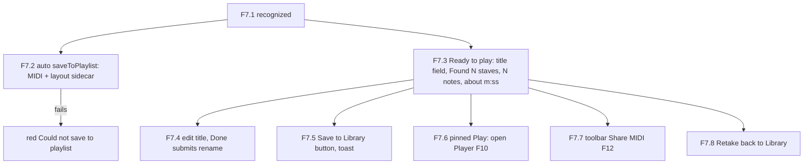

| ID | Step | Expected | Acceptance check | Risk / evidence |
|---|---|---|---|---|
| F7.1 | Outcome recognized | `PageRecognitionService.outcome`: requires staffCount>0, non-empty MIDI, ≥1 noteLayout | Sample page → `.recognized` with staffCount≥1 | `PageRecognitionService.swift:154-161` |
| F7.2 | Auto-save | Every recognized scan is immediately added to Library (MIDI + `<stem>.layout.json`); idempotent | After Result appears, Library has the entry (`NEW`) even if user taps Retake | `ResultScreen.swift:265-291`; `PlaylistStore.swift:127-155`. R: on save error the Play button still plays ad-hoc MIDI as "Your music" (`:318-325`) and nothing is stored; layout sidecar failure only logged → silently no Sheet mode |
| F7.3 | Summary | Title "Ready to play"; "Found 4 staves · 52 notes · about 0:24" with singular/plural handled | 1 staff/1 note → "1 stave · 1 note" | `ResultScreen.swift:46-50` (`summary`) |
| F7.4 | Rename | Editable title (default "Scan Oct 17, 2026 at 9:30 AM"); applied on Return, Save, or Play | Edit + Play → Library shows new title; empty title → keeps old | `ResultScreen.swift:95-99,300-307` |
| F7.5 | Save to Library | Already saved; button confirms under edited title → toast "Saved to Library", button disabled | Tap → toast, label "Saved to Library" | `ResultScreen.swift:310-315`. R: label implies action but nothing new happens (could confuse; duplicate of auto-save) |
| F7.6 | Play | Pinned coral button (pulse unless Reduce Motion); opens Player with autoplay | Tap → Player shows title; audio within 2 s; **Back returns to Result** (not Library) | `ResultScreen.swift:171-190,318-325`; `RootFlowView.swift:29` |
| F7.7 | Share MIDI | Toolbar share of the saved `.mid` | Share sheet offers file named after capture stem (not title) | `ResultScreen.swift:72-77`. R: file name = capture timestamp (e.g. `20261017-093012-123.mid`), whereas Library/Player share uses the title → inconsistent |
| F7.8 | Retake | Toolbar "Retake" = `dismiss()` | Returns to Library | `ResultScreen.swift:66-71`. R: not Camera (see F5.5) |

## F8 — Review & correct recognition (what actually exists)

**There is no note editor.** "Correction" = (a) rename title, (b) visually compare overlay vs photo, (c) mark individual notes wrong and rate accuracy, which is **saved only to the local diagnostics log** (never sent anywhere). Fix-ups must be done by rescanning.

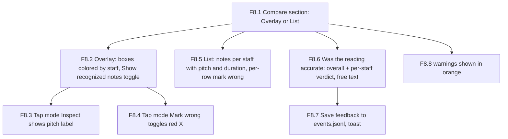

| ID | Step | Expected | Acceptance check | Risk / evidence |
|---|---|---|---|---|
| F8.1 | Compare header | Segmented Overlay/List; summary mono line "52 notes · 4 staffs · layout attention · 4100 ms" | Both modes selectable; `layout midi-fallback` shows approximate token strip with disclaimer | `OMRCompareView.swift:50-98,148`. R: developer jargon ("layout attention", ms) shown to end users |
| F8.2 | Overlay | Boxes scaled from pixel rect to view; min 8 pt; toggle hides | Boxes align with noteheads on sample (±1 notehead width) | `OMRCompareView.swift:109-128`. R: alignment on rotated/portrait-landscape photos and `layoutSource == midi-fallback` [RUNTIME] |
| F8.3 | Inspect | Tap box → "#12 C#4 quarter · staff 1" label | Tap twice toggles selection | `OMRCompareView.swift:177-190` |
| F8.4 | Mark wrong | Tap toggles red + "Marked wrong: N", Clear marks | Mark 3, count shows 3; Clear → 0 | `:208-214,243-247`. R: boxes <22 pt in a small thumbnail are hard to tap; no zoom in Compare |
| F8.5 | List mode | Per staff sections with `#idx pitch duration` rows | Count per staff equals header "· N notes" | `:79-87` |
| F8.6 | Verdicts & note | Overall + per-staff pickers, optional text | Selecting verdict enables **Save feedback** (disabled when `feedback.isEmpty`) | `:228-253` |
| F8.7 | Save feedback | Toast "Feedback saved" | `events.jsonl` has a `feedback` event with capture name, wrongNotes | `:260-274`. **R: feedback never leaves the device** (only copied by Developer → Copy as prompt); toast/label imply it was submitted; product gap |
| F8.8 | Warnings | `details.warnings` rendered orange | Parse with warnings → each shown | `:72-74` |

## F9 — Failure, low-quality and retry

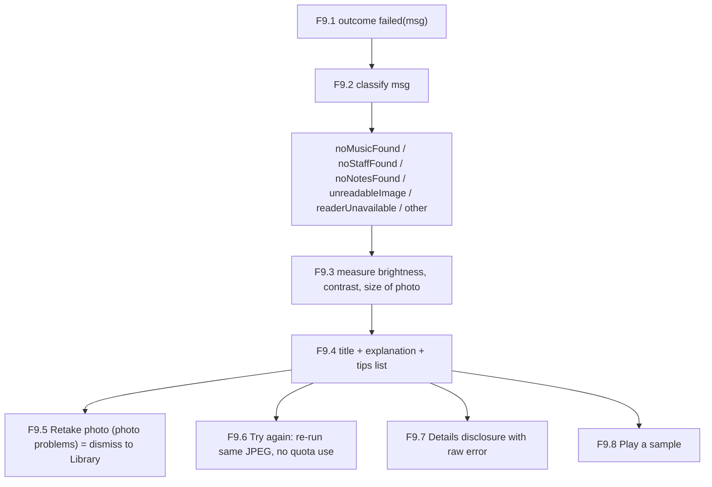

| ID | Step | Expected | Acceptance check | Risk / evidence |
|---|---|---|---|---|
| F9.1 | Failure outcomes | `failed("no music staff found… (staffCount 0)")`, `"no notes recognized (N staffs)"`, `"recognizer returned empty MIDI"`, thrown errors via `String(describing:)` | Feed a blank white image → failed, not crash | `PageRecognitionService.swift:154-161,307-311` |
| F9.2 | Classification | Pure string matching on lowercased message | Unit cases: each substring → expected `ScanFailure` | `ScanFailure.swift:21-35`. R: **brittle** — a model/ORT error containing "session"/"model" is shown as "reader isn't ready"; "cancelled" from queue guard maps to `.other` |
| F9.3 | Photo quality | 64×64 luma mean/std + pixel size → tips "dark", "washed out", "small" (<1000 px) | Dark photo (mean<80) shows torch tip first | `ScanFailure.swift:113-147`; `ResultScreen.swift:259-262` |
| F9.4 | Message | Orange triangle, title, explanation, up to 4–7 tips | Each of 6 reasons shows its copy (see `ScanFailure.title/explanation`) | `ResultScreen.swift:120-147` |
| F9.5 | Retake photo | Shown when `isPhotoProblem` (all but readerUnavailable); `dismiss()` | Returns to Library | `ResultScreen.swift:139-142`. R: same "Retake ≠ Camera" issue (F5.5) |
| F9.6 | Try again | `retry()` bumps `attempt`; reruns recognition with the already saved JPEG; **does not touch quota** | Failure → Try again → Reading screen again; `omr.freeScansUsed` unchanged | `ResultScreen.swift:200-205,87`. R: on a *photo* problem "Try this photo again" will fail again identically (wasted time); on `readerUnavailable` it is the right action |
| F9.7 | Details | Raw message in monospaced selectable text | Long-press selects | `ResultScreen.swift:145-147` |
| F9.8 | Play a sample | Opens Library sample "Ode to Joy" in Player | Works with 0 scans | `ResultScreen.swift:157,363-371` |
| F9.9 | `.comingSoon` branch | Unreachable in production (`StubRecognitionService` only) | grep shows only tests/previews use stub | `ResultScreen.swift:148-155`. R: dead copy "Recognition coming soon" would be wrong in release if ever hit |
| F9.10 | Edge inputs | Non-music photo, handwritten music, multi-page spread, skewed/curved page, glare, very small image, screenshot of PDF | Each yields either a sensible recognized result or one of the six failure reasons — never a crash/hang | R: no `fixtures` for tuplets, key signatures, multi-row (TODO.md "Regression fixtures"); handwritten explicitly unsupported (tip text) |

## F10 — Player / reader view & playback controls

Entry: Result Play, Library row, mini-player tap. `PlayerScreen.onAppear → controller.open(route)`.

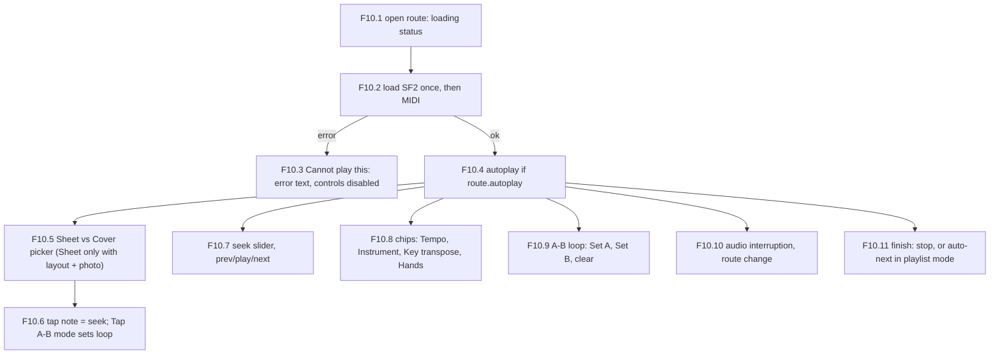

| ID | Step | Expected | Acceptance check | Risk / evidence |
|---|---|---|---|---|
| F10.1 | Open | Header "NOW PLAYING" (ad-hoc) / "PLAYING FROM LIBRARY"; status "Loading…" until ready; transport & slider disabled until `ready` | Open sample → within 2 s `player.playPause` enabled | `PlayerView.swift:82,230`; `PlaybackController.swift:253-261` |
| F10.2 | Load | Bundled `GeneralUser-GS.sf2` parsed once per process; MIDI from playlist file; transpose reset to 0 per song | Second song opens faster; transpose label "Key 0" | `PlayerView.swift:26-32`; `PlaybackController.swift:262-273`. R: SF2 file size/parse time on first play [RUNTIME]; missing SF2 → "GeneralUser-GS.sf2 not bundled" |
| F10.3 | Load error | Status in coral: "Can't play this: …" raw Swift error text | Delete the `.mid` file by hand → open → message shown, no crash | `PlaybackController.swift:286-290`. R: raw `\(error)` string leaks developer text to user |
| F10.4 | Autoplay | Starts after load when `autoplay` (Result Play, row tap); mini-player open does `autoplay=false` | Play from Result → audio starts without extra tap; mini-player open doesn't restart | `RootFlowView.swift:84-89`; `PlayerRoute.swift` |
| F10.5 | Sheet / Cover | Segmented picker only when scan has layout + photo; Sheet shows photo with note boxes, 380 pt tall, fit-to-page; Zoom −/+ (1×–4×); Follow toggle retained but **does not pan/zoom** | Scan opens in Sheet; sample opens Cover; zoom in → scroll | `PlayerView.swift:70,84-101`; `SheetFollowView.swift:22-23,56`; TODO "Sheet Follow fit-to-page". R: dead "Follow" control (no effect) is misleading; pre-sheet-mode scans fall back to Cover silently |
| F10.6 | Note tap | Tap within 36 pt of a note box seeks to its onset; "Tap A–B" toggle makes taps mark loop A then B | Tap 5th note → position jumps; highlight coral follows playback | `PlayerView.swift:152-181`; `PlaybackController.swift:230-233`. R: highlight timing on speaker vs Bluetooth latency is **unverified** (TODO "Blocked / waiting on user") |
| F10.7 | Transport | Play/pause, prev (restart if >3 s in, else previous track), next (disabled at list end), slider scrub with elapsed/total | Scrub to 50% → time label tracks while dragging, seeks on release | `PlayerView.swift:183-232`; `PlaybackController.swift:133-154` |
| F10.8 | Chips | Tempo 0.5–2× (persisted), Instrument 12 GM programs incl. "Original", Key −12…+12 per song, Hands menu only if ≥2 note tracks (Right/Left hand naming inferred from generic names) | Change instrument mid-play → timbre changes ≤200 ms; tempo persists after relaunch; transpose resets on next song | `PlayerView.swift:234-343`; `AppSettings.swift:12-25,37`. All free (no paywall gating) |
| F10.9 | A–B loop | "Set A" → "Set B"; B before A swaps; ✕ clears; loop wraps and re-sounds held notes (per TODO) | Loop 0:05–0:10 repeats gaplessly ≥3×; clear stops looping | `PlayerView.swift:273-305`; `PlaybackController.swift:160-187` |
| F10.10 | Interruptions | Phone call/Siri pauses and resumes if `.shouldResume`; headphones unplugged pauses; media-services reset rebuilds graph | Start playback, call comes in → pauses; end call → resumes; unplug headphones → pauses | `Packages/SF2Player/.../SF2MIDIPlayer.swift:433-462`. R: **no `UIBackgroundModes: audio`** → playback stops when app is backgrounded/locked [RUNTIME]; no lock-screen Now Playing / remote commands (`MPNowPlayingInfoCenter`/`MPRemoteCommandCenter` not present) — product gap for a music app; silent switch behavior unverified |
| F10.11 | End of track | Single scan: stops; playlist mode (`advanceOnFinish`): opens next entry and autoplays | Row-tap playback auto-advances to next row; Result-Play stops at end | `PlaybackController.swift:42-57`. R: playlist order = scans newest-first then 2 samples, so auto-advance runs into samples |
| F10.12 | Rotation / iPad | Player is a `ScrollView`; layout adapts | Landscape: all controls reachable by scrolling; no clipped chips | [RUNTIME] |
| F10.13 | Library sheet from Player | Sheet with LibraryScreen (no camera/photos buttons); choosing a row loads + autoplays | Open sheet → pick other scan → sheet closes, new track plays | `PlayerView.swift:136-148` |

## F11 — Library playback, mini-player, playlist behavior

| ID | Step | Expected | Acceptance check | Risk / evidence |
|---|---|---|---|---|
| F11.1 | Mini-player | Bottom card on Library and Camera while `controller.current != nil`: artwork, title, instrument · tempo, play/pause, next, thin progress | Start song, pop to Library → mini-player visible and live; tap opens Player without reload | `LibraryScreen.swift:139-145,168-413`; `RootFlowView.swift:84-89` |
| F11.2 | Delete playing item | Row action available for playing scan | Delete playing scan → expect playback stops or mini-player updates | R: not handled — controller keeps playing deleted entry; `entry` becomes nil → title falls back to route title; `next/prev` then disabled (`PlaybackController.swift:61-67,107-108`) [RUNTIME] |
| F11.3 | Playlist order | Newest scans first, then samples; prev/next follow this order | Add 2 scans → order newest→oldest→samples | `PlaylistStore.swift:67-72` |
| F11.4 | App relaunch | Library persisted; playback not restored | Kill app → relaunch: Library intact, mini-player absent | `PlaylistStore.swift:41-42` |

## F12 — Save, share & export

Only export format is **MIDI (SMF format 1, 480 TPQ)** via `ShareLink`. No PDF/MusicXML/audio export, no Files integration, no "Open in…" import of MIDI/PDF.

| ID | Step | Expected | Acceptance check | Risk / evidence |
|---|---|---|---|---|
| F12.1 | Library share | Row menu → Share MIDI → system share sheet with `<Title>.mid` | AirDrop to Mac opens in a MIDI app and plays same notes | `LibraryScreen.swift:207-214`; `MIDIExport.swift:17-47` |
| F12.2 | Player share | Toolbar share of loaded item (library entry or ad-hoc MIDI) | Share while loaded; hidden when nothing loaded | `PlayerView.swift:123-130` |
| F12.3 | Title → filename | Banned characters `/\:?%*|"<>` replaced by `-`, 80-char cap, empty → "Music" | Title `A/B: C?` → `A-B- C-.mid` | `MIDIExport.swift:23-29` (unit-testable) |
| F12.4 | Temp files | Fresh `tmp/midi-export/<uuid>/` per share | After 20 shares tmp dir grows; cleared by OS | `MIDIExport.swift:39-47`. R: never explicitly cleaned (inferred low) |
| F12.5 | Result share | See F7.7 (name = capture stem) | — | inconsistency |
| F12.6 | Save photo | The scan photo is stored in app Documents only; **no "Save to Photos"** | — | by design (no feature); gap |

## F13 — Settings

Entry: gear on Library/Camera → sheet. Sections: **Playback** (Instrument, Tempo), **About** (Version [hidden dev unlock], Rate, Privacy, Source code & license). Developer section hidden. **There is no Pro/Subscription/Restore/Manage-subscription row** (see Product gaps and P6).

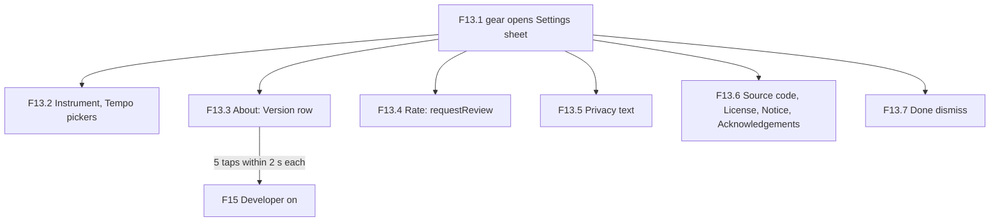

| ID | Step | Expected | Acceptance check | Risk / evidence |
|---|---|---|---|---|
| F13.1 | Open/close | Sheet with Done; Camera-hosted gear also opens it | Open from both; Done dismisses; Library state unchanged | `SettingsView.swift:57-76` |
| F13.2 | Playback prefs | Navigation-link pickers bind to `AppSettings.shared`; same values as Player chips | Change in Settings, open Player → chip shows same value | `SettingsView.swift:78-93` |
| F13.3 | Version | "1.0 (30)" style from bundle; 5 rapid taps unlock Developer w/ toast hints at ≤3 remaining | 5 taps <2 s apart → "Developer mode on" | `SettingsView.swift:99-116`; `AppSettings.swift:94-102` |
| F13.4 | Rate | `requestReview()` | iOS may silently show nothing (rate-limited) — acceptable; no fallback to App Store URL | R: tapping does nothing visible when iOS throttles (no feedback) |
| F13.5 | Privacy | In-app summary: on-device, telemetry events, purchases handled by Apple | In-app text agrees with the live privacy page (2026-10-12); the **web page's** claim "Deleting a scan … removes them" is **not true for the scan photo (F2.7)** | `SettingsView.swift:193-202` |
| F13.6 | Source/licenses | Repo link, AGPL text, NOTICE, Acknowledgements; large ORT notice rendered lazily | Open NOTICE (≈24 KB) and ORT notices (≈320 KB) without UI hitch | `SettingsView.swift:204-276` |
| F13.7 | Missing items | No reset-quota/Pro status/Manage subscription/Restore/Support/Terms link, no data deletion control, no telemetry opt-out | n/a | **R: telemetry has no opt-out in-app** (privacy page relies on it being anonymous) — product/compliance decision |

## F14 — Cross-cutting: errors, offline, interruptions, storage, rotation

| ID | Step | Expected | Acceptance check | Risk / evidence |
|---|---|---|---|---|
| F14.1 | Offline everything | Recognition, playback, Library fully offline; telemetry and StoreKit degrade softly | Airplane mode: scan sample → play → share works; only paywall/restore affected (P2.5/P6.6) | `ReadingView.swift:100`; `Analytics.swift:214-218` |
| F14.2 | Low disk | Capture save, index write and MIDI write errors surface as red text where shown | Fill disk → scan → "Save failed: …" / "Could not save to playlist: …" | `ResultScreen.swift:237,287`. R: error strings are raw Swift `\(error)` |
| F14.3 | Memory pressure | Page session dropped on `didReceiveMemoryWarning`; next scan re-warms | See F1.8 | |
| F14.4 | Crash recovery | Uncaught-exception handler logs; no crash UI | Force NSException → relaunch shows log entry | `DiagnosticsLog.installUncaughtExceptionHandler` |
| F14.5 | Rotation / iPad / Dynamic Type / VoiceOver | Camera preview rotates; lists adapt; a11y identifiers present | Landscape camera shot is upright; Dynamic Type XXXL doesn't truncate CTA labels; VoiceOver reads note counts on sheet | **[RUNTIME]** not verifiable statically |
| F14.6 | Dark mode / Reduce Motion | Pulse and scan-line animations disabled with Reduce Motion | Toggle in iOS settings | `ReadingView.swift:61`, `ResultScreen.swift:397` |
| F14.7 | Localization | English strings only (hard-coded) | Switch device language → UI remains English | gap (listing is en-US only) |

## F15 — Developer / diagnostics (hidden)

Unlock: 5 version taps (F13.3). Rows: Event log, Copy diagnostics as prompt, model self-test (Gate-1), SegNet self-test, Compare test staff, Turn off.

| ID | Step | Expected | Acceptance check | Risk / evidence |
|---|---|---|---|---|
| F15.1 | Event log | `LogScreen` lists capped in-memory + JSONL file events | Run a scan → entries `capture`, `recognition`, `playback` appear | `DiagnosticsLog.swift` |
| F15.2 | Copy as prompt | Builds a markdown prompt with device header, timings, per-staff counts, memory | Pasted text contains `preprocess_mode`, `peak_mb` | `PromptBuilder.swift`, `PromptCopy.swift` |
| F15.3 | Self-tests | Gate-1 C-scale runs model-only check | Self-test shows pass on device | `Gate1RootView.swift`; TODO: oracle fixture needs Mac |
| F15.4 | Persistence | Developer mode persists across launches until turned off | Relaunch → section still visible | `AppSettings.swift:107-112`. R: shipped to all users; any user can see raw logs (low risk, local only) |

---

# Part B — Free-to-paid / in-app purchase workflow (P) — priority deep dive

**Business model (from code + docs):** free = **5 page scans per day**; **Music Reader Pro** = unlimited scans. Two auto-renewable subscriptions in one group (`22457674`, "Music Reader Pro"): `com.ragnus.vp.pro.monthly` ($4.99 / P1M, group level 2) and `com.ragnus.vp.pro.yearly` ($29.99 / P1Y, level 1), no intro offer, Family Sharing off (`OMRSheetCam.storekit`, `docs/asc/IAP_SETUP.md`). StoreKit 2, **on-device entitlement only** — no server, no receipt validation, no App Store Server Notifications. Nothing else is gated: instruments, tempo, transpose, loop, hands, sheet mode, MIDI share, Library are all free.

**Components:** `ScanQuota` (`App/Services/ScanQuota.swift`) → `StoreKitManager` (`App/Services/StoreKitManager.swift`) → `PaywallView` (`App/Features/Paywall/PaywallView.swift`) presented from `RootFlowView.swift:50-52`. **Two `StoreKitManager` instances exist**: the root `@StateObject` (`RootFlowView.swift:15`, injected into the paywall) and a private one inside `ScanQuota` (`ScanQuota.swift:11`). They share state **only through `UserDefaults["omr.isPro"]`**. `isPro` is not `@Published`; nothing in the UI observes it.

Static verdict column: **OK** = code appears to meet the acceptance check; **GAP** = code appears NOT to meet it (candidate bug / product gap); **?** = cannot be decided without running StoreKit (see test matrix S-cases).

## P0 — Pro workflow overview (diagram only, no steps)

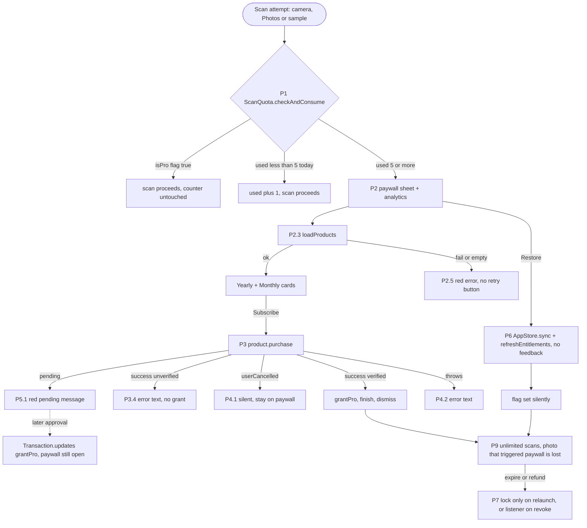

## P1 — Free-tier limits & paywall triggers

Entry: any scan attempt (F5). The **only** code path that sets `showPaywall = true` is `ScanQuota.checkAndConsume` (`ScanQuota.swift:33`).

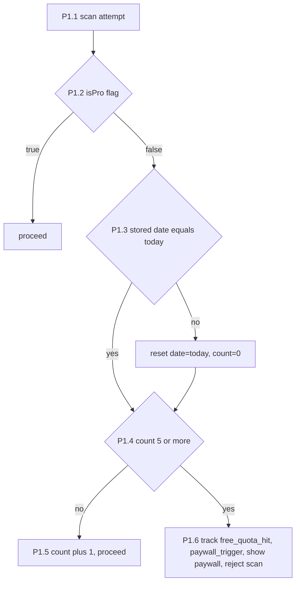

| ID | Step | Expected | Acceptance check (strict) | Verdict / evidence |
|---|---|---|---|---|
| P1.1 | Limit constant | Free limit is exactly 5 scans per local calendar day, identical in code, paywall copy, ASC description, review notes | `ScanQuota.freeDailyLimit == 5`; paywall strings contain "5"; `docs/asc/metadata/review_information/notes.txt` says 5 | OK — `ScanQuota.swift:7`; `PaywallView.swift:16,107`; notes.txt |
| P1.2 | Fresh install state | `omr.freeScansUsed` absent, `omr.freeScansDate` absent, `omr.isPro` absent → treated as 0 / not Pro | Fresh install, scan #1: after it `freeScansUsed == 1`, `freeScansDate == today(yyyy-MM-dd)` | OK — `ScanQuota.swift:24-29,36` |
| P1.3 | What consumes quota | Camera shutter result, Photos pick result, Try-sample (Library or Camera) — each exactly once per `handlePhoto` call | Do one of each → counter +3. Retry ("Try again"), opening Library, playing, sharing, Settings, Cancel-after-start: counter unchanged *after* the initial +1 | OK as coded — `RootFlowView.swift:57-62`. **Design flag:** sample picture burns a real scan |
| P1.4 | Quota taken before outcome | — (desired: do not charge a scan that fails because of the app) | Force warmup failure (F1.7) or classify `readerUnavailable`; scan → counter should be **unchanged** | **GAP** — consumed at `RootFlowView.swift:58` before `ResultScreen.process`; failed/cancelled/reader-not-ready scans cost 1 of 5 |
| P1.5 | Boundary: scans 1–5 pass | `used` 0…4 allowed; `used` becomes 5 after 5th scan | Scan 5 times → all 5 reach Reading; paywall not shown | OK — `ScanQuota.swift:30,36` |
| P1.6 | Boundary: 6th scan blocked | `used >= 5` → returns false, sets `showPaywall`, fires `free_quota_hit` then `paywall_trigger{reason:"quota"}`; user stays on Camera/Library; **no JPEG saved, no Result** | 6th scan: paywall appears ≤0.3 s; `omr.freeScansUsed` stays 5; exactly 2 telemetry POSTs; Library unchanged | OK — `ScanQuota.swift:30-35` |
| P1.7 | Every further attempt re-triggers | Each blocked attempt shows paywall again and re-sends both events | 3 blocked attempts → 3 `paywall_view`, 3 `free_quota_hit` | OK/expected; **telemetry inflation** (events per attempt, not per user-day) |
| P1.8 | Day rollover | Counter resets when device-local date string changes | Set `freeScansDate` to yesterday + count 5 → next scan allowed, count 1, date today | OK — `ScanQuota.swift:15-19,25-28`. `DateFormatter` uses the device's current time zone **and calendar/locale** (no `en_US_POSIX`, unlike `CaptureStore.timestamp`): switching region/calendar (e.g. to Buddhist/Japanese) changes the year string → spurious early reset — **?** [RUNTIME] |
| P1.9 | Clock / time-zone manipulation | — | Set device clock forward one day → quota resets (known, by design); travelling west across midnight can **grant** a second reset within 24 h | **GAP (product decision)** — client-side counter only |
| P1.10 | Visibility of remaining scans | User can see how many free scans are left before hitting the wall | After scan 3 UI shows "2 scans left today" (or equivalent) | **GAP** — `scansRemaining` exists (`ScanQuota.swift:40-45`) but is **never read** by any view |
| P1.11 | Single Pro-check site | Pro status consulted only in `checkAndConsume` | `rg "isPro"` shows exactly the `ScanQuota` reads + manager | OK (see P9.1) |
| P1.12 | Duplicate manager | `ScanQuota.shared` owns its own `StoreKitManager` (starts a 2nd `Transaction.updates` listener + entitlement refresh) | Instrument `StoreKitManager.init` count at launch = 1 | **GAP** — 2 instances (`ScanQuota.swift:11`, `RootFlowView.swift:15`); doc `docs/omr-iap-xcode-prompt.md` admits this ("intentional for simplicity"). Double `finish()` is harmless; double telemetry not emitted by listener |
| P1.13 | Where paywall can be opened | Free users can discover Pro without hitting the wall (Settings row / banner) | Settings has "Music Reader Pro" row | **GAP** — no other entry; IAP_SETUP.md step 3 ("open Pro from the app") describes a control that does not exist |

## P2 — Paywall presentation & StoreKit product load

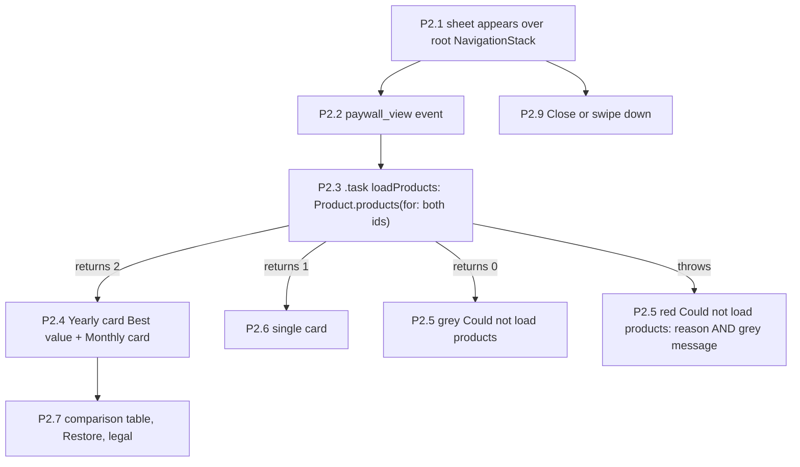

| ID | Step | Expected | Acceptance check (strict) | Verdict / evidence |
|---|---|---|---|---|
| P2.1 | Presentation | Modal sheet titled "Upgrade" (inline), headline "Music Reader Pro", subtitle "Free: 5 page scans a day. Music Reader Pro unlocks unlimited scans." Close in top-left | Triggered from Camera and from Library: sheet shows identical content; Close visible; swipe-down works | OK — `PaywallView.swift:9-62`; sheet at `RootFlowView.swift:50` |
| P2.2 | Funnel event | `paywall_view` each time sheet appears | One POST per presentation | OK — `PaywallView.swift:55`. Note: also fires when sheet re-renders `onAppear` after nested nav (n/a) |
| P2.3 | Product request | `Product.products(for: {monthly, yearly})` run on every presentation; results sorted yearly first then by price | With StoreKit config attached: `products.count == 2`, `products[0].id == yearly` | OK — `StoreKitManager.swift:46-60`, `PaywallView.swift:61` |
| P2.4 | Loaded UI | Yearly card (accent border, "Best value" pill) above Monthly; each shows localized `displayPrice` (US: $29.99 / $4.99) and **Subscribe** button | Prices equal config in US storefront; "Best value" true (yearly < 12×monthly: $29.99 < $59.88 ⇒ ≈50% off) | OK — `PaywallView.swift:21-26,65-101`. R: price shown **without period** ("$29.99" under title "Yearly"); no per-month equivalent, no savings %, no intro/trial text — App Store 3.1.2(a) expects billing period + price clearly shown; **verify with App Review** |
| P2.5 | Load failure / offline | Clear, actionable message **and a retry control** | Airplane mode → open paywall: one message (not two), a **Retry** button; after reconnect Retry loads cards without dismissing | **GAP** — thrown error sets red `purchaseError` ("Could not load products: …") *and* the grey line "Could not load products. Check your connection…" both render (`StoreKitManager.swift:58`, `PaywallView.swift:27-33,35-41`); no retry button — reload only on re-present |
| P2.6 | Empty / partial result | If a product ID is missing in the storefront, show remaining plan(s) or the empty-state message | Remove yearly from config → only Monthly card, no crash; remove both → empty-state message | OK structurally (`yearlyProduct`/`monthlyProduct` optionals) — **?** copy for "not available in your region" absent |
| P2.7 | Loading state | While loading, show spinner/skeleton; error text must not flash before the request starts | Open paywall for the first time after launch: first frame must not show "Could not load products" | **GAP** — `isLoading` is false until `.task` runs, and `products.isEmpty && !isLoading` is true on the first render of the first presentation (products are cached in the root manager afterwards) → message flashes (`PaywallView.swift:27`); there is no loading indicator at all |
| P2.8 | Comparison + legal | Free vs Pro columns ("5 scans / day" vs "Unlimited scans"); renewal text; Terms (Apple standard EULA) and Privacy (`grepawk.com/music-reader/privacy.html`) links | Tap each link opens Safari; privacy URL returns 200 with page dated 2026-10-12 (**verified 2026-10-17 via web fetch**) | OK — `PaywallView.swift:103-142`. R: no link to manage subscription; Terms = Apple's generic EULA (fine if no custom EULA in ASC — **?** unverified) |
| P2.9 | Dismiss | Close button or swipe-down; no purchase side-effects; `quota.showPaywall` returns to false so next block can re-present | Close → paywall gone; next blocked scan shows it again (not stuck) | OK — `$quota.showPaywall` binding. No `paywall_dismiss` event (cannot compute conversion funnel dropoff precisely) |
| P2.10 | Layout / a11y | Scrollable; Dynamic Type; iPad; landscape | XXXL text and iPad: Subscribe buttons reachable, nothing clipped | **?** [RUNTIME] |
| P2.11 | Copy accuracy | Paywall must not claim features that don't exist | "All instruments" in Free column ✔ (instruments free); "Same player & instruments" in Pro column ✔ | OK — `PaywallView.swift:103-120` vs `AppSettings.swift:12-25` |

## P3 — Purchase success

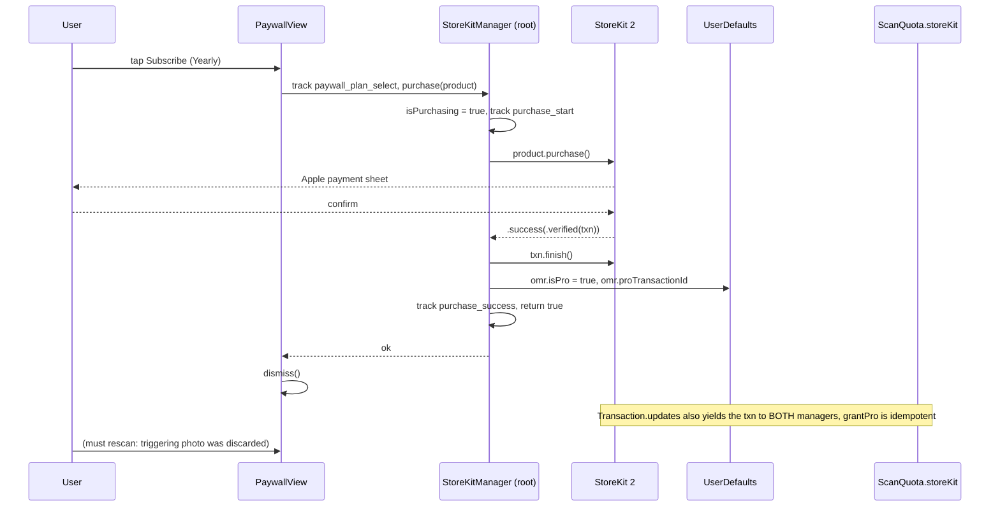

| ID | Step | Expected | Acceptance check (strict) | Verdict / evidence |
|---|---|---|---|---|
| P3.1 | Tap Subscribe | `paywall_plan_select{plan:"yearly"/"monthly"}` fires **before** purchase; `purchase_start{product:<id>}`; both Subscribe buttons disabled and spinner shown on both cards | Tap → within 100 ms both buttons disabled; 2 events in order | OK — `PaywallView.swift:79-96`; `StoreKitManager.swift:62-66`. R: spinner appears on both cards (global `isPurchasing`), Restore/Close remain tappable mid-purchase |
| P3.2 | Apple sheet | Standard StoreKit sheet with correct product name ("Music Reader Pro Yearly"), price, renewal terms; environment tag `[Sandbox]` in TestFlight/sandbox | In Xcode StoreKit testing and sandbox the sheet title/price match config/ASC | **?** localization of display names depends on ASC state (TODO: build 30 + subs waiting for review since 2026-10-09 — unverified) |
| P3.3 | Verified success | `.success(.verified)` → `transaction.finish()` → `omr.isPro=true` + `omr.proTransactionId` → `purchasedProductIDs += id` → `purchase_success` → returns true → paywall dismissed | After purchase: `UserDefaults omr.isPro == true`; paywall closed; `purchase_success` sent once; transaction not in `Transaction.unfinished` | OK — `StoreKitManager.swift:68-76`, `PaywallView.swift:83-84` |
| P3.4 | Unverified success | `.success(.unverified)` must not grant Pro; user gets a clear message; transaction left unfinished for later re-verification | Config → Editor → Default StoreKit Errors → Verification failed (or SKTestSession verification error), purchase → Pro **not** granted, paywall stays, message readable | **?/GAP** — `checkVerified` throws, falls into generic `catch` (`:86-90`) → raw `error.localizedDescription` (likely cryptic "VerificationResult.VerificationError…"), event `purchase_fail{reason:error}` is indistinguishable from other errors; user may have been charged |
| P3.5 | Immediate unlock | Next scan after purchase is allowed regardless of counter | With counter at 5: buy → scan → reaches Reading; `freeScansUsed` stays 5 | OK — `ScanQuota.swift:23` reads UserDefaults flag each call (works despite 2 managers) |
| P3.6 | Success feedback | User gets visible confirmation ("You're Pro — unlimited scans") and a Pro indicator persists | After purchase a toast/banner appears; Settings shows "Music Reader Pro · renews …" | **GAP** — sheet silently closes; no confirmation, no Pro status anywhere |
| P3.7 | Resume interrupted intent | The scan that triggered the paywall continues after purchase | Scan #6 → buy → Reading starts with the **same** photo | **GAP** — `handlePhoto` returned false and dropped the `CapturedPhoto` (`RootFlowView.swift:57-62`); user must reshoot/re-pick (Camera still open; Photos picker closed) |
| P3.8 | Concurrent listener | `Transaction.updates` also delivers the new transaction to both managers | No double-grant side effects: `omr.isPro` stays true, `proTransactionId` unchanged, no extra telemetry | OK/? — idempotent (`:105-122`); **?** because `finish()` is called by 3 callers |
| P3.9 | App killed after payment, before `purchase()` returns | Entitlement granted on next launch | Kill app while Apple sheet shows "Processing", relaunch → within 5 s `omr.isPro == true` (via `Transaction.updates` unfinished + `currentEntitlements`) | **?** [RUNTIME] StoreKit test S17 |
| P3.10 | Plan change | Switching Monthly↔Yearly (upgrade/crossgrade) | n/a in-app (paywall unreachable for Pro users); only through iOS Settings → Subscriptions | Not supported in-app (gap; no `manageSubscriptionsSheet`) |
| P3.11 | Purchase while not signed into App Store | Apple sign-in prompt appears; on cancel → treated as P4.1 | Sign out of App Store in sandbox → tap Subscribe → prompt, not crash | **?** [RUNTIME] |

## P4 — Purchase cancel & failure

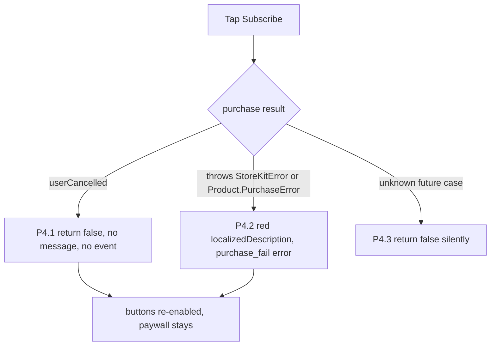

| ID | Step | Expected | Acceptance check (strict) | Verdict / evidence |
|---|---|---|---|---|
| P4.1 | User cancels Apple sheet | No error text; buttons re-enabled; paywall stays; optional `purchase_cancel` event | Cancel in sheet → `isPurchasing == false` within 0.5 s, `purchaseError == nil`, free tier unchanged | OK for UI (`StoreKitManager.swift:77-78`). **GAP (analytics):** no event → funnel `purchase_start` without terminal event |
| P4.2 | Payment error (declined card, network, `notAvailableInStorefront`, `purchaseNotAllowed`, parental restriction) | Red message with plain-language text; paywall stays; `purchase_fail` | Enable Xcode "Fail Transactions" → message appears under cards, red box; second attempt after disabling succeeds | OK — `StoreKitManager.swift:86-90`. R: shows raw `localizedDescription` (often English Apple string); `reason` always `"error"` — no distinction by error type |
| P4.3 | Unknown result | `@unknown default` returns false with no message/event | n/a | Silent failure path (`:83-84`) — low |
| P4.4 | Double-tap / rapid retry | Second tap ignored while purchasing | Rapid double tap yields one `purchase_start` | OK — `.disabled(storeKit.isPurchasing)` (`PaywallView.swift:94`) |
| P4.5 | Error state clearing | Old error cleared when a new purchase/restore/load begins | After failure then success, red box gone | OK — `purchaseError = nil` at `:48,64,95` |
| P4.6 | Interrupted purchase (payment method needs attention / 2FA) | Same as P4.2 or pending; no Pro until complete | Xcode "Interrupted Purchase" setting → message shown, no Pro, no stuck spinner | **?** S9 |
| P4.7 | Free tier intact | Failure never mutates counters or flag | After any failed purchase: `omr.isPro` unchanged, `freeScansUsed` unchanged | OK |

## P5 — Pending / Ask to Buy / SCA

| ID | Step | Expected | Acceptance check (strict) | Verdict / evidence |
|---|---|---|---|---|
| P5.1 | `.pending` returned | Neutral (not error-red) message "Waiting for approval — we'll unlock Pro when it's approved"; buttons re-enabled; no Pro | Xcode Ask-to-Buy on → Subscribe → pending text visible, `omr.isPro == false`, paywall open | **GAP (UX)** — text "Purchase is pending approval." is shown through the **error style** (red box) and logged as `purchase_fail{reason:pending}` (`StoreKitManager.swift:79-82`) |
| P5.2 | Approved while app is running | `Transaction.updates` → `grantPro`; UI reflects it (paywall auto-closes / toast) | Approve in Transaction Manager → `omr.isPro == true` within 5 s; paywall dismisses or shows "Pro unlocked" | **GAP** — flag is granted (`:106-118`) but paywall stays open with the stale "pending" message; no UI observer of `isPro`; user thinks nothing happened |
| P5.3 | Approved while app is closed | Pro active on next launch | Approve, cold-launch → scan #6 allowed | **?** via `Transaction.updates`/`currentEntitlements` (S8) |
| P5.4 | Declined | Message cleared / "Request declined"; free tier continues | Decline in Transaction Manager → no Pro; paywall may be re-tried | **GAP** — no signal: red pending text lingers until next action |
| P5.5 | Child account can't see scans | While pending, free quota still applies | After pending, 6th scan still blocked | OK |

## P6 — Restore purchases

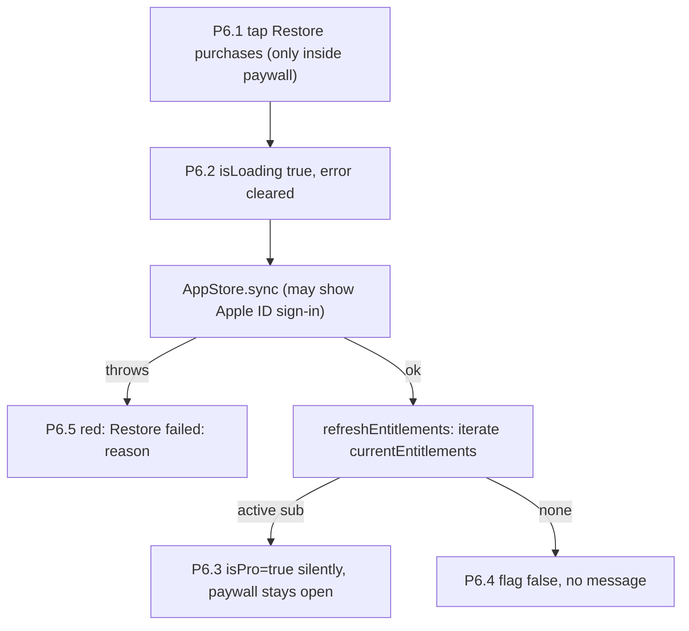

| ID | Step | Expected | Acceptance check (strict) | Verdict / evidence |
|---|---|---|---|---|
| P6.1 | Discoverability | Restore reachable from paywall **and** Settings (App Review expects an obvious Restore) | Settings → "Restore purchases" row exists; works with no quota hit | **GAP** — only inside the paywall (`PaywallView.swift:43-46`) which only a quota-blocked free user can see; a Pro user on a new device who has fewer than 5 scans/day never sees Restore |
| P6.2 | In progress | Spinner/disabled button during `AppStore.sync()` | Tap Restore → visible progress, double-tap ignored | **GAP** — `isLoading` set but **nothing renders it**; button stays enabled → user sees no reaction for seconds; may be prompted for Apple ID password |
| P6.3 | Restore succeeds | Pro unlocked **and user told**; paywall auto-closes | With active sub in test account: after Restore `omr.isPro == true`, paywall dismissed or "Restored ✔" shown | **GAP** — flag/`purchasedProductIDs` updated silently; sheet remains (`StoreKitManager.swift:93-103`) |
| P6.4 | Nothing to restore | "No active subscription found for this Apple ID" | Fresh account → Restore → explicit message | **GAP** — silent no-op; `refreshEntitlements` sets flag false |
| P6.5 | Sync failure / user cancels Apple ID prompt | Cancel is silent; network failure shows retryable message | Cancel sign-in → no red text; airplane mode → "Restore failed: …" | **GAP/?** — user cancel surfaces as red "Restore failed: …" (`:101`); text is raw `localizedDescription` |
| P6.6 | Offline restore | Clear "You're offline" message | Airplane mode → tap Restore → single readable message | ? (see P6.5) S10 |
| P6.7 | Restore with expired sub | Flag stays false; message "Subscription expired on <date>" | Expire in Transaction Manager → Restore → no Pro | OK on flag; GAP on message |
| P6.8 | Telemetry | `restore_start/success/fail` events | n/a | **GAP** — no restore events (`PrivacyInfo` lists only purchase funnel) |

## P7 — Entitlement checks, renewal, expiry, refund, offline

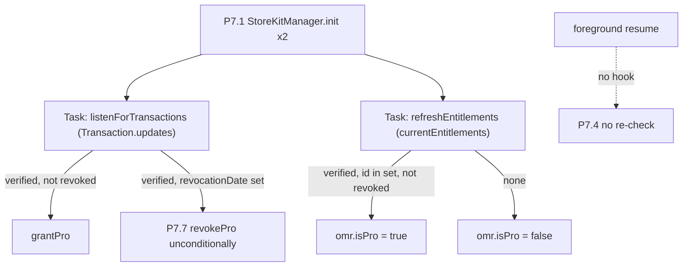

| ID | Step | Expected | Acceptance check (strict) | Verdict / evidence |
|---|---|---|---|---|
| P7.1 | Launch-time check | On every cold start entitlement is recomputed from `Transaction.currentEntitlements` (verified only, product ∈ {monthly,yearly}, `revocationDate == nil`) and **overwrites** `omr.isPro` | Seed `omr.isPro=true` with no entitlement → after launch + ≤3 s flag becomes false; with active sub → true | OK — `StoreKitManager.swift:124-141`. R: runs async after init; gating during the first second uses the **stale cached flag** (harmless for free→Pro, lets an expired user scan once) |
| P7.2 | Unverified entitlement | Unverified JWS ignored | Verification-failure session → flag false | OK (`continue` on error, `:134-136`) |
| P7.3 | Renewal while running | `Transaction.updates` fires on renewal; flag stays true | Accelerated renewal (test session rate) → 3 renewals, `omr.isPro` stays true, no flicker | **?** S13 |
| P7.4 | **Expiry while the app stays alive** | Pro locks at `expirationDate` (or next foreground) | Start Pro session, Expire subscription in Transaction Manager without killing app, foreground/background/scan: scan #6 should show paywall | **GAP** — no expiry/`scenePhase` hook; `Transaction.updates` is not expected to fire for plain expiry (StoreKit semantics, confirm with S12); flag stays true until process restart. A backgrounded app can stay "Pro" for days after lapse |
| P7.5 | Expiry then relaunch | Flag false; scans limited again with stored counter/date | Relaunch after expiry → scan #6/day blocked | OK — via P7.1 |
| P7.6 | Refund / revocation | Pro removed **only if no other valid entitlement remains**; user informed | Buy yearly, then monthly, refund monthly → still Pro | **GAP** — listener calls `revokePro()` unconditionally (`:113-115`), ignoring other active transactions; corrected only at next launch by P7.1 |
| P7.7 | Listener grants without checking dates | A delivered transaction that is already expired / superseded (`isUpgraded`) must not grant Pro | Replay an old unfinished expired transaction via Transaction Manager → flag must stay false | **?/GAP** — listener grants if `revocationDate == nil` only, no `expirationDate`/`isUpgraded` check (`:110-112`) |
| P7.8 | Auto-renew off (user cancelled) | Pro continues until period end, then lapses | In sandbox: cancel renewal → Pro until expiry → P7.4/P7.5 | OK by StoreKit semantics; no in-app notice |
| P7.9 | Billing retry / grace period | Pro retained while Apple's grace is active, if enabled in ASC | Xcode "Billing Grace Period" on → flag true during grace, false after | **?** (ASC grace setting not verifiable; `currentEntitlements` semantics) S15 |
| P7.10 | Offline | Pro user offline remains Pro (cached signed transactions) | Launch in airplane mode with active sub → `omr.isPro` true | OK for flag (cached); **?** whether `currentEntitlements` is non-empty offline [RUNTIME] S18 |
| P7.11 | Tamper resistance | Entitlement not trivially forgeable | Edit `omr.isPro` in a jailbroken/backup copy → unlimited scans until next launch re-check | By design (`docs/omr-iap-xcode-prompt.md`: "no server verification"). Flag is plaintext UserDefaults, no Keychain/receipt check |
| P7.12 | Multiple Apple IDs / account switch mid-session | Entitlement reflects current account | Sign out/in other Apple ID in sandbox while running → flag stale until relaunch | **GAP (low)** — no `Transaction.updates` for account change handled |

## P8 — Reinstall, new device, backup/restore

| ID | Step | Expected | Acceptance check (strict) | Verdict / evidence |
|---|---|---|---|---|
| P8.1 | Delete + reinstall (same Apple ID, active sub) | Pro restored **automatically** without tapping Restore | Reinstall, launch online: `omr.isPro == true` ≤5 s; scan #1–#10 not limited | **?** StoreKit 2 `currentEntitlements` normally syncs; S16 |
| P8.2 | Reinstall when auto-sync didn't return entitlement | User has an obvious Restore path | Settings → Restore works | **GAP** — Restore only in paywall (P6.1); the user must burn 5 free scans first |
| P8.3 | Counter after reinstall | Quota counter persists across reinstall (to prevent reset abuse) | Delete/reinstall same day after 5 scans → still blocked | **GAP (by design)** — counter is in UserDefaults; reinstall = +5 scans |
| P8.4 | New device, same Apple ID | Same as P8.1; counter independent | iPad install → Pro on iPad | ? |
| P8.5 | iCloud/iTunes backup restore to a device with different Apple ID | `omr.isPro=true` copied from backup is corrected at launch | Restore backup containing `isPro=true`, sign in different ID → after launch flag false | OK via P7.1 (but gating before first refresh uses stale flag) |
| P8.6 | Offline reinstall | Pro restored once online; free quota available meanwhile | Reinstall offline → scans limited to 5 until online | ? |
| P8.7 | Library after reinstall | Previously saved scans are gone (app sandbox deleted) — expectation set? | n/a | gap: no iCloud sync/export of Library; a paying user loses all scans on reinstall |

## P9 — How paid features unlock and lock

| ID | Step | Expected | Acceptance check (strict) | Verdict / evidence |
|---|---|---|---|---|
| P9.1 | Scope of Pro | Pro changes exactly one behavior: unlimited page scans | `rg "isPro"` Sources → only `ScanQuota` + `StoreKitManager`; no view reads it | OK — consistent with paywall copy/ASC/review notes |
| P9.2 | Unlock latency | Effective immediately after grant, **no relaunch** | Purchase → next scan allowed immediately | OK (P3.5) |
| P9.3 | Lock triggers | Expiry, refund/revocation, account change → free limits resume | See P7.4–P7.7, P7.12 | **GAP** — locks lazily (cold start) except revocation |
| P9.4 | UI differentiation | Pro status visible (badge/row), free users see remaining scans | Settings shows plan + renewal/expiry date + Manage subscription | **GAP** — none |
| P9.5 | Content kept after lapse | All previously scanned music remains playable/shareable | Expire Pro → open Library, play, share every scan | OK — gate only in `handlePhoto` |
| P9.6 | Mid-scan lapse | An in-flight scan completes | Lapse during Reading → Result still arrives | OK (no re-check) |
| P9.7 | Counter semantics after lapse | Count resumes from today's stored value | Pro for 3 days then lapse → first free day starts at stored counter or 0 if date changed | OK |

## P10 — Telemetry, privacy & compliance of the purchase funnel

Funnel events emitted (all via `Analytics.track`, anonymous UUID, POST `https://photo.grepawk.com/api/telemetry`, 10 s timeout, errors swallowed): `free_quota_hit`, `paywall_trigger{reason}`, `paywall_view`, `paywall_plan_select{plan}`, `purchase_start{product}`, `purchase_success{product}`, `purchase_fail{reason: pending|error}`.

| ID | Step | Expected | Acceptance check | Verdict / evidence |
|---|---|---|---|---|
| P10.1 | Event sequence | Quota block → `free_quota_hit`, `paywall_trigger`, `paywall_view`; Subscribe → `paywall_plan_select`, `purchase_start`, `purchase_success`/`purchase_fail` | Run P3 with a request logger; exact order and counts | OK — `ScanQuota.swift:31-32`, `PaywallView.swift:55,80`, `StoreKitManager.swift:66,75,81,88` |
| P10.2 | Missing terminal events | `purchase_cancel`, `restore_*`, `paywall_dismiss`, `pro_expired` | — | **GAP** — funnel cannot separate cancel vs abandon |
| P10.3 | Prop filter | Props `product`, `plan`, `reason` survive; PII regex only drops PII keys | Unit test `track` with key `platform` | **GAP (low)** — regex `lat` matches `platform` (`Analytics.swift:53`) so `app_open{platform}` is dropped silently |
| P10.4 | No PII | No Apple ID, receipt, transaction id, price in events | Inspect payloads | OK (product id only; `omr.proTransactionId` stays local) |
| P10.5 | Disclosures consistent | Privacy manifest, in-app Privacy text, live privacy page, ASC "App Privacy" answers all say: telemetry + purchase history, no tracking | Compare four sources | In-app, manifest, web page agree (page dated 2026-10-12). **ASC console App Privacy status unverified** — TODO.md (2026-10-09) lists publishing it as open |
| P10.6 | Subscription disclosure | In-app renewal text + links; ASC metadata contains Terms/Privacy | Legal footer present | OK in-app (`PaywallView.swift:133-142`) |
| P10.7 | Offline telemetry | Failure silent | Airplane mode → purchase flow unaffected | OK |

## P11 — App Review & operations reachability

| ID | Step | Expected | Acceptance check | Verdict / evidence |
|---|---|---|---|---|
| P11.1 | Reviewer reaches paywall as documented | Review notes: "tap **Try sample picture** on Library home, go back and repeat" ×6 | On a fresh install: Library home → Try sample (1) → Result → back; Library now has a scan → **button no longer present** → cannot repeat from Library | **GAP** — `LibraryScreen.swift:69-73` shows Try-sample only while `scans.isEmpty`; the Camera screen's always-visible sample button (`CameraScreen.swift:48,153-164`) works, and notes also say "(or scan / import any photo)" — reachable but notes are misleading |
| P11.2 | Sandbox purchase in review | Subscribe → sandbox sheet → Pro → unlimited scans | Test per S4/S5/S10 in TestFlight build | ? — subscriptions `WAITING_FOR_REVIEW` with build 30 since 2026-10-09 per TODO.md (not re-verified; ASC status workflow is read-only and was not run) |
| P11.3 | StoreKit config wiring | `OMRSheetCam.storekit` selectable and attached to the Run scheme so dev builds load products | Open scheme → Run → Options → StoreKit Configuration shows the file | **GAP** — file is **not referenced** in `project.pbxproj` and the shared scheme has no `StoreKitConfigurationFileReference` (both grep = 0); `docs/omr-iap-xcode-prompt.md` Step 3 was never committed. Only `PaywallScreenshotTests` loads it via `SKTestSession(contentsOf:)` |
| P11.4 | Automated coverage | Unit tests for quota boundary, rollover, purchase result mapping, restore | `rg "ScanQuota|StoreKitManager" Tests` | **GAP** — only `PaywallScreenshotTests` (opt-in, skipped by default) touches IAP; **no test** for quota or purchase/restore state machine |
| P11.5 | Pricing parity | Config prices = ASC prices | $4.99 / $29.99 USD in config and `docs/asc/IAP_SETUP.md`, `notes.txt` | OK on paper; ASC live values unverified |

---

# Part C — StoreKit test plan (for the Pro flows)

## C.1 Environments (use all three; they test different things)

| Env | How | Good for | Notes |
|---|---|---|---|
| **E1 Xcode StoreKit Testing** (local, no Apple servers) | Xcode → Product → Scheme → Edit Scheme → Run → Options → *StoreKit Configuration* = `OMRSheetCam.storekit`; run on simulator/device; use **Debug → StoreKit → Manage Transactions** | Everything deterministic: Ask to Buy, fail/interrupt, expire, refund, grace/retry, renewal rate, storefront | **Today the file is not attached to the scheme nor listed in `project.pbxproj`** (P11.3): add it first or products will not load in Xcode runs. The config has `_failTransactionsEnabled:false`, no intro offer, storefront USA, `en_US` |
| **E2 XCTest + `SKTestSession`** | `import StoreKitTest`; `SKTestSession(contentsOf: repo/OMRSheetCam.storekit)`; `resetToDefaultState()`/`clearTransactions()` per test; `disableDialogs = true` to auto-confirm | CI regression of `StoreKitManager` + `ScanQuota` (none exist today; see C.3). Pattern already used by `Tests/PaywallScreenshotTests.swift:24-29` | API names below are from Apple's StoreKitTest framework as I know them (`buyProduct`, `askToBuyEnabled`, `approveAskToBuyTransaction`, `declineAskToBuyTransaction`, `failTransactionsEnabled`, `expireSubscription`, `refundTransaction`, `forceRenewalOfSubscription`, `timeRate`, `setSimulatedError(_:forAPI:)`); **confirm exact signatures in the Xcode SDK — not verified on this Linux box** |
| **E3 Sandbox via TestFlight / dev build** | ASC → Users and Access → Sandbox → create tester; iOS Settings → App Store → Sandbox Account. Products take ~15 min after creation (`docs/asc/IAP_SETUP.md`) | Real ASC product metadata, localized names/prices, receipt signing, App Review parity | Sandbox accelerates renewals (commonly 1 week→3 min, 1 month→5 min, 1 year→1 h, max ~6 renewals — verify current Apple docs). Ask to Buy cannot be simulated here — use E1/E2 |

Simulating the quota without 5 real scans (simulator; untested here):
`xcrun simctl spawn booted defaults write com.ragnus.vp omr.freeScansUsed -int 5` and
`xcrun simctl spawn booted defaults write com.ragnus.vp omr.freeScansDate "$(date +%F)"`.
Force Pro/non-Pro: `… omr.isPro -bool true|false`.

## C.2 Test case matrix (every case lists flow IDs it validates)

| # | Case | Setup | Steps | Expected (acceptance) | Flows |
|---|---|---|---|---|---|
| S1 | Products load, US | E1, config attached | Hit quota → paywall | 2 cards, yearly first, "$29.99"/"$4.99", Best value pill | P2.3–P2.4, P11.5 |
| S2 | Load failure | E1: Editor → Default StoreKit Errors → Load Products = network error (or E2 `setSimulatedError(..., forAPI: .loadProducts)`) | Open paywall | **Single** readable message + Retry (today: two messages, no Retry — expected to FAIL) | P2.5 |
| S3 | Missing / partial products | Delete one product in config copy | Open paywall | Remaining card only; none → empty message; no crash | P2.6 |
| S4 | Buy Monthly | E1 | Subscribe Monthly → Confirm | `omr.isPro=true`, paywall dismissed, `purchase_start`→`purchase_success`, next scan allowed, counter unchanged | P3.1–P3.5 |
| S5 | Buy Yearly | E1/E3 | same | same; `proTransactionId` set | P3 |
| S6 | User cancels sheet | E1 | Subscribe → Cancel | no error, buttons re-enabled, no Pro, (desired) `purchase_cancel` | P4.1 |
| S7 | Fail transaction | E1 Editor → Fail Transactions on (or E2 `failTransactionsEnabled`) | Subscribe | red message, `purchase_fail{error}`, no Pro; turn off → retry succeeds | P4.2, P4.5 |
| S8 | Ask to Buy | E1 Editor → Enable Ask to Buy (E2 `askToBuyEnabled=true`) | Subscribe → pending; then Manage Transactions → **Approve** (separate run: **Decline**); also approve while app killed | pending message neutral; on approve Pro ≤5 s **and UI reflects it**; decline → message cleared | P5.1–P5.4 |
| S9 | Interrupted purchase | E1 Editor → Interrupt Purchases | Subscribe | no Pro, no stuck spinner, readable message | P4.6 |
| S10 | Restore matrix | (a) active sub, (b) none, (c) offline/sync error (`forAPI: .syncStore`-style error — confirm name), (d) cancel Apple ID prompt | Paywall → Restore | (a) Pro + confirmation; (b) "nothing to restore"; (c) retryable error; (d) silent | P6.2–P6.6 |
| S11 | Verification failure | E1 Editor → Default StoreKit Errors → Verification | Subscribe; relaunch | Pro never granted from unverified; user message | P3.4, P7.2 |
| S12 | Expire while running | E1 Manage Transactions → Expire Subscription (E2 `expireSubscription(productIdentifier:)`) | Don't kill app; background/foreground; scan | scan blocked immediately after foreground (today: stays Pro until relaunch — expected FAIL) then relaunch → blocked | P7.4–P7.5, P9.3 |
| S13 | Renewal | E1 Editor → Subscription Renewal Rate (e.g. 1 renewal / 30 s) or E2 `timeRate`/`forceRenewalOfSubscription` | Buy, wait 3 renewals | `omr.isPro` never flips false; no telemetry spam | P7.3 |
| S14 | Refund (+ multi-product) | E1 Manage Transactions → Refund; case B: buy yearly then monthly, refund monthly | observe flag live and after relaunch | A: Pro off; B: **still Pro** (today: off until relaunch — expected FAIL) | P7.6 |
| S15 | Grace / billing retry | E1 config Settings → Billing Retry on Renewal + Billing Grace Period | Let renewal fail | Pro retained during grace per ASC choice; lapses after | P7.9 |
| S16 | Reinstall | E1 keep transactions; delete app; reinstall | Launch online, then offline | Pro auto-restored ≤5 s with no tap; if not, Settings→Restore exists (today: none) | P8.1–P8.2, P8.6 |
| S17 | Kill mid-purchase | E1 | Subscribe → confirm → force-quit before dismissal → relaunch | Pro granted from unfinished transaction | P3.9 |
| S18 | Offline Pro launch | E1/E3 | Pro account, airplane mode, cold launch, scan ×7 | never blocked; flag true | P7.10 |
| S19 | Storefront / currency | E1 Editor → Default Storefront (e.g. JPN) / unsupported region | Open paywall | localized `displayPrice`, no hard-coded "$"; unavailable storefront handled | P2.4, P2.6 |
| S20 | Quota boundary & rollover | defaults write (C.1) | scans 4→5→6; set date yesterday | 5 pass, 6th blocked + 2 events; rollover resets; failed scan consumption (P1.4) | P1.5–P1.8 |
| S21 | Sandbox account switch / cross-device | E3 | switch tester mid-session; second device same tester | flag recomputed at next launch; no crash | P7.12, P8.4 |
| S22 | Review path | E3 fresh install | follow `notes.txt` literally | reaches paywall (today Library "Try sample" disappears after first scan) | P11.1 |
| S23 | Time zone / clock | simulator date change | cross midnight, change TZ west | resets once per local day; document accepted bypass | P1.8–P1.9 |
| S24 | Two-manager consistency | E1 with logging in `StoreKitManager.init` | launch, buy, refund | single source of truth; no divergent state between root manager and `ScanQuota`'s | P1.12 |

## C.3 Automated tests to add (none exist; suggested file `Tests/ProEntitlementTests.swift`)

1. `ScanQuota` with injected `UserDefaults` suite + clock: boundary 5/6, rollover, Pro bypass, `scansRemaining`.
2. `StoreKitManager` with `SKTestSession`: S4, S6, S7, S8, S10, S12, S14 asserting `isPro` and `purchasedProductIDs`.
3. `Analytics.track` filter: `platform` survives; PII keys dropped.
4. UI test (`XCUITest`) with launch arg seeding quota=5: 6th scan shows paywall (`PaywallView` has no accessibility identifiers today — add `paywall.subscribe.yearly`, `paywall.restore`, `paywall.close`).

---

# Product gaps and UX observations

Facts are from code unless marked (inferred). Ordered roughly by impact.

**Monetization / Pro**
1. **No Pro visibility or management in Settings**: no "Music Reader Pro" row, no plan/renewal date, no Restore, no "Manage subscription" (`.manageSubscriptionsSheet`/App Store link). Restore is reachable only after exhausting free scans (P6.1, P8.2). Strong App Review and support risk.
2. **Scans-left indicator absent** (`scansRemaining` unused). The 5/day wall appears as a surprise on the 6th scan; first-run has no mention of the limit (F1.1, P1.10).
3. **Charged-for-failure quota**: failed, cancelled, reader-not-ready and sample scans burn quota (P1.4). Suggest consuming only on `.recognized`, or refunding on failure.
4. **Lost scan after paywall**: purchase/restore does not resume the pending photo (P3.7). Keep the `CapturedPhoto` and continue automatically.
5. **Silent success/failure states** in Paywall: no confirmation after purchase/restore, pending text styled as error, no spinner on Restore, no Retry on product-load failure, flash of error before load (P2.5–P2.7, P3.6, P5.x, P6.x).
6. **Entitlement freshness**: re-run `refreshEntitlements()` on `scenePhase == .active` and compute from `expirationDate`; make `isPro` observable and de-duplicate the two `StoreKitManager`s (inject one) (P1.12, P7.4, P7.6).
7. Pricing clarity: show period and per-month equivalent/savings, consider free trial/intro offer (none configured) and a "Cancel anytime" line (P2.4). Consider alternatives to the hard daily wall (e.g. 5 *successful* scans, weekly pool).
8. Telemetry funnel is incomplete (`purchase_cancel`, `restore_*`, `paywall_dismiss`) and per-attempt events inflate counts (P1.7, P10.2).
9. Reinstall resets both the free counter and the user's Library (P8.3, P8.7) — consider iCloud/CloudKit or Files export so paying users do not lose scans.

**Capture / recognition**
10. **"Retake" goes to Library, not Camera** (camera route is popped on scan, `RootFlowView.swift:59-61`; Result's Retake = `dismiss()`).
11. **Cancel doesn't cancel** (F6.4/F6.8): parse keeps running and blocks the next scan; likely leaves orphan JPEG and may still add a Library entry.
12. No framing guide/overlay, no auto-capture/stability detection, no "page too small / too dark" pre-check before consuming a scan (the quality hints only appear *after* failure, F9.3). A pre-flight quality check would also protect the quota.
13. No multi-page / PDF / Files / Share-extension import; no batch or multi-photo stitching for systems spanning pages.
14. Honest ETA: copy says "usually a few seconds" while TODO.md says real-device parse time is not yet measured.
15. Reading progress resets to 0% at warm-up → read phase (F6.6).
16. Photos import: iCloud-only assets rely on `PHAsset` path without authorization (F4.5).

**Review / correction**
17. **No actual correction**: no note editing, key/time-signature override, clef fix, or re-run with a different crop. "Mark wrong" and "Save feedback" only write the local log and never reach the developer (F8.7); toast text "Feedback saved" over-promises. Offer "Send feedback" (explicit consent) or remove the control from consumer UI.
18. Developer jargon on consumer screens ("layout attention", ms) (F8.1).

**Playback / reader**
19. No `UIBackgroundModes: audio`, no lock-screen/Control Center controls (F10.10). Playback stops when you leave the app — a major gap for practice use.
20. "Follow" toggle has no effect (SheetFollowView no longer pans) (F10.5); either remove or restore auto-scroll for multi-system pages.
21. Delete: no confirmation/undo; deleting the playing track isn't handled (F2.5, F11.2); capture photo isn't deleted (F2.7) — storage leak and contradicts the live privacy policy.
22. Silent loss when `index.json` is corrupt (F2.9).
23. Share filename inconsistency Result vs Library (F7.7).

**Accessibility / platform**
24. English only; no localization (F14.7). Rotation, iPad layouts, Dynamic Type unverified (F14.5).
25. Telemetry has no in-app opt-out (F13.7) — consider a Settings toggle.
26. Docs drift: `TODO.md` says live privacy/support pages still claim "no analytics/no IAP", but the live privacy page (fetched 2026-10-17, dated 2026-10-12) already describes telemetry and subscriptions — TODO needs an update; `IAP_SETUP.md` refers to an "open Pro from the app" control that does not exist; `docs/omr-iap-xcode-prompt.md` Step 3 (attach StoreKit config) never made it into the project.

---

# Riskiest spots (top 5)

1. **P7.4 / P7.6 / P9.3 — Entitlement lock-down is lazy and partly wrong.** Expired subs stay Pro until process restart; refund of one product revokes Pro even if another is valid; no foreground refresh. (Revenue leak and wrong lock.)
2. **P6.1 / P6.2–P6.4 / P8.2 — Restore is hidden and silent.** Only in the paywall, no progress, no result message; reinstall/new-device Pro users may be stuck seeing the free wall. App Review (3.1.1) and support risk.
3. **P1.4 / P3.7 / F6.8 — Quota charged before success + photo lost after purchase.** Failures, cancels, reader-not-ready and samples burn the 5/day; after paying, the user must rescan.
4. **F6.4 / F6.8 / F6.9 — Cancel and backgrounding semantics of the recognizer.** Cancel doesn't stop the parse (blocks the next scan, may still save a Library entry), no timeout, no background-task protection — hang/jetsam risk on large photos (memory unverified on device).
5. **F2.7 / F2.9 / F10.10 — Data & audio lifecycle.** Deleting a scan leaves the photo on disk (policy mismatch), corrupt index silently empties Library, playback dies on background/lock (no audio background mode, no Now Playing).

# What could not be verified (all of it needs a Mac/device)

- Anything that depends on running UI: layouts, rotation, Dynamic Type, VoiceOver, iPad, animations, haptics, actual timing (parse time, warm-up ~30 s, SF2 load).
- StoreKit runtime semantics: `Transaction.updates` on expiry/refund, `currentEntitlements` offline/after reinstall, `AppStore.sync` UI/prompts, unverified-transaction behavior, pending/approval delivery. All P-verdicts marked **?** need cases S1–S24.
- App Store Connect state: product approval/propagation, grace-period setting, App Privacy answers, build 30 + subscription review outcome (TODO.md dated 2026-10-09; the `asc-status` workflow was **not** run).
- Camera permission edge cases (app kill on permission change), `PHAsset` fallback without Photos authorization, iCloud-only photos, audio route/Bluetooth latency, headphone/call interruption on device.
- Whether `Cancel` leaves a late Library entry (F6.8), and whether torch is switched off on leaving Camera (F3.7).
- Test-suite status: tests were not run (no Xcode); only file inventory read. CI (`ios-sim.yml`) results not queried.
- `/workspace/omr-audit` already contained an **older git checkout of the same repo (f0e32a8, 2026-10-03)**; it was not modified except for adding audit files here. All findings use the existing clone at `/workspace/omr-sheet-cam` (fetched; up to date with origin/main) (HEAD `736d0f6`).
